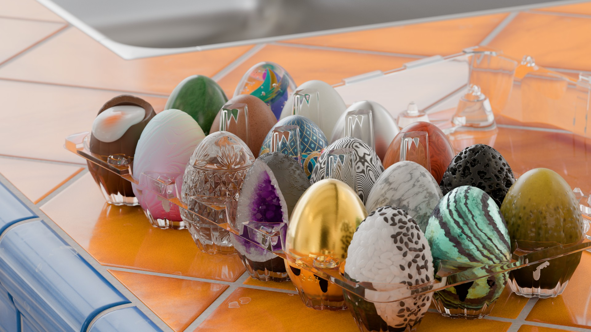

👋 Introduction
---------------------------------------

PrismRT is a physically based path tracer for OpenUSD, glTF and OBJ scenes with MaterialX materials, compiled through NVIDIA MDL. It renders on the CPU (Embree, oneTBB) or on the GPU with hardware ray tracing (Vulkan on Windows, Metal on macOS), and every device runs the same path tracer.


<sub>The countertop scene of [MaterialEggs](https://github.com/stehrani3d/MaterialEggs) by stehrani3d (MIT licence), rendered by PrismRT on Vulkan.</sub>

You can use it through:

* **usdview and other Hydra hosts**, with the hdPrism render delegate ([Hydra usage](docs/hydra.md), [material support](docs/hydra_materials.md));
* **the `PrismRT` command line**, for USD, glTF and OBJ files;
* **C++**, through the `prism` library: public headers in `include/prism/` (`Renderer`, `Scene`, `Session`), design and API notes in [docs/sdk_design.md](docs/sdk_design.md);
* **Python**, with the `prismrt` package: NumPy arrays in and out, progressive rendering, AOVs, USD loading ([docs/python.md](docs/python.md), [examples](examples/python)). For now it is built from source; see [docs/python.md](docs/python.md#wheel) for a Windows wheel.

PrismRT is in active development, and its API may still change before 1.0. Builds and pre-releases are on the [Releases](https://github.com/joaovbs96/prism-rt/releases) page.


✅ Features
---------------------------------------

**Rendering**
* Unidirectional path tracing with next-event estimation and multiple importance sampling over a light table.
* UsdLux lights (dome, distant, rect, disk, sphere, cylinder), `ShapingAPI` spotlights and IES profiles, textured emissive surfaces sampled as lights, light and shadow linking.
* Random-walk subsurface scattering and absorbing transmission from the materials' volume coefficients.
* Adaptive sampling, and denoising with Intel Open Image Denoise (on the CPU and Metal) or vk_oidn (on Vulkan), using albedo and normal guides ([denoising](docs/denoising.md)).
* Colour management with OpenColorIO: an ACEScg working space by default, and the ACES 2.0 SDR view for 8-bit outputs ([colour management](docs/color_management.md)).

**Materials**
* Every material is MaterialX compiled through MDL, to native code on the CPU and to HLSL on the GPU: `standard_surface`, OpenPBR, `UsdPreviewSurface`, glTF PBR ([glTF](docs/gltf.md)), and OBJ/MTL as `open_pbr_surface` ([OBJ](docs/obj.md)).
* Known MaterialX/MDL problems are repaired in memory at load time, never in your files ([compatibility notes](docs/materialx_compatibility.md)).
* `PrismRT --material look.mtlx` renders a document on the USD Working Group's Standard Shader Ball ([material preview](docs/material_preview.md)).

**Geometry and scenes**
* Meshes with OpenSubdiv subdivision, load-time displacement, primvars, GeomSubsets, holes and left-handed orientation; analytic USD spheres.
* Native instancing and PointInstancer, UsdSkel skinning, mesh purpose and visibility, `--time` for animated stages.
* Incremental edits in Hydra and in the SDK's `Scene::commit`.

**Output**
* AOVs: albedo, normal, depth, position, diffuse, specular and emission lighting, and object/instance ids for masks and picking.
* Multi-part EXR through OpenImageIO, and every RenderProduct of a scene's RenderSettings with its RenderVars as layers.


🖥️ Render Devices
---------------------------------------

The shared path tracer, [`shaders/integrator/path_tracer.h`](shaders/integrator/path_tracer.h), is a C++ template that also compiles as HLSL, on top of a small backend for each device.

| Device | Platforms | Ray tracing | Status |
| --- | --- | --- | --- |
| `cpu` | Windows, macOS | Embree | The reference device. |
| `vulkan` | Windows with `VK_KHR_ray_query` (NVIDIA RTX, AMD RX 6000+, Intel Arc) | Inline ray queries; the HLSL kernel compiled to SPIR-V by DXC | Tested on NVIDIA. |
| `metal` | macOS on Apple silicon (M1 and newer; ray-tracing hardware from M3) | Inline ray queries; DXC to DXIL, then Apple's Metal shader converter | Tested on an M5. |

The default `auto` picks Metal on macOS and Vulkan elsewhere, and falls back to `cpu` when no GPU device is usable. To choose a device:

* command line: `--device auto|cpu|vulkan|metal` (`PrismRT --list-devices` lists them);
* Hydra and usdview: the `PRISM_DEVICE` environment variable or the `prism:device` render setting.

The GPU devices compile a kernel for each new set of materials and cache it, so later runs start in a few seconds. Measurements and CPU/GPU image comparisons: [docs/gpu_devices.md](docs/gpu_devices.md) and [docs/performance.md](docs/performance.md).


⚠️ Requirements
---------------------------------------

* Windows x64 with Visual Studio 2022, or macOS on Apple silicon with Xcode or the Command Line Tools. PrismRT is written in C++20; the CMake presets need CMake 3.21+.
* OpenUSD 26.08 (with Python, imaging and GL for usdview), MaterialX, OpenSubdiv, Embree 4, oneTBB, OpenImageIO, OpenColorIO, Open Image Denoise and the [NVIDIA MDL SDK](https://github.com/NVIDIA/MDL-SDK) (open source; a build without CUDA is enough). [`tools/deps.json`](tools/deps.json) holds every dependency version. Older OpenImageIO, TBB and MaterialX builds are best effort ([docs/deployment.md](docs/deployment.md#older-dependency-stacks-best-effort)).
* For the GPU devices: DXC and the Vulkan SDK; the Metal device also needs Apple's Metal shader converter.
* Python 3.11 for usdview and the `prismrt` package.


🛠️ Building
---------------------------------------

The full Windows walkthrough is in [docs/windows_vulkan.md](docs/windows_vulkan.md). In short:

1. Clone with submodules: `git clone --recursive https://github.com/joaovbs96/prism-rt.git`.
2. Build the dependencies or point to your own. On Windows, `tools/build_deps_local.ps1` builds OpenUSD, MaterialX and OpenSubdiv at the versions in `tools/deps.json`, and vcpkg provides OpenImageIO and OpenColorIO ([deployment](docs/deployment.md#dependency-versions)).
3. Copy `cmake/PrismLocalDependencies.cmake.example` to `cmake/PrismLocalDependencies.cmake` and fill in the package roots (or use `CMAKE_PREFIX_PATH`). On Windows, also copy `prism_local_env.ps1.example` to `prism_local_env.ps1` for the runtime paths.
4. Configure and build: `cmake --preset prism-hydra`, then `cmake --build --preset prism-hydra`. On macOS, use the `prism-hydra-mac` preset.
5. Set up the environment before running anything: `. ./prism_env.ps1` on Windows, `. ./prism_env.sh` on macOS.

Render from the command line:

```powershell
./build/RelWithDebInfo/PrismRT.exe --scene assets/scenes/InOneWeekend.usda --camera /World/Camera --spp 256 --output render.exr
# every RenderProduct of the scene's RenderSettings, with its RenderVars as EXR layers:
./build/RelWithDebInfo/PrismRT.exe --scene scene.usda --output-dir renders
# a MaterialX document on the built-in shader ball:
./build/RelWithDebInfo/PrismRT.exe --material assets/materials/standard_surface_marble_solid.mtlx --output marble.png
```

Open usdview with PrismRT (select **PrismRT** in the renderer menu):

```powershell
powershell -ExecutionPolicy Bypass -File run_usdview.ps1 path/to/scene.usda   # Windows
./run_usdview.sh path/to/scene.usda --renderer PrismRT                      # macOS
```

Running `PrismRT` with no arguments prints the command-line help. Tests run with `ctest --test-dir build -C RelWithDebInfo` (the `gpu` label marks the tests that may open a GPU device).

On Windows, keep the install or extract folder short (such as `C:\PrismRT`) or enable long paths: PrismRT checks the path length at start and tells you if it is too long ([path length](docs/deployment.md#path-length)).


🐛 Known Limitations
---------------------------------------

* Motion blur is in progress ([plan](docs/motion_blur.md)). Curves and OpenVDB volumes are not implemented yet ([volumes](docs/volumes.md), [roadmap](docs/feature_roadmap.md)).
* Linux is not built or tested yet, though the Vulkan device and the CMake are meant to be portable. The Python wheel is Windows-only for now.
* The Vulkan device has only been tested on NVIDIA GPUs.
* Hydra and usdview open USD files only; glTF and OBJ load through the command line, the SDK and Python.


⚖️ Licensing
---------------------------------------

PrismRT is licensed under the Apache License, Version 2.0. See [LICENSE](./LICENSE) for the full text and [NOTICE](./NOTICE) for the copyright notice.

The image at the top shows the [MaterialEggs](https://github.com/stehrani3d/MaterialEggs) assets (© 2024 stehrani3d, MIT licence), with an HDRI courtesy of [Poly Haven](https://polyhaven.com/) (CC0; credit to Sergej Majboroda and Greg Zaal, as the MaterialEggs README gives it); the assets are not included in this repository.

The material preview's scene in `resources/shaderball` is the [Standard Shader Ball](https://github.com/usd-wg/assets/tree/main/full_assets/StandardShaderBall) of the USD Working Group's assets (geometry and textures by Chris Rydalch, specification and validation by André Mazzone, after Thomas Anagnostou's original scene), used unchanged under the [Creative Commons Attribution 4.0 International licence](https://creativecommons.org/licenses/by/4.0/) (`resources/shaderball/LICENCE`, `resources/shaderball/ATTRIBUTION.md`).
