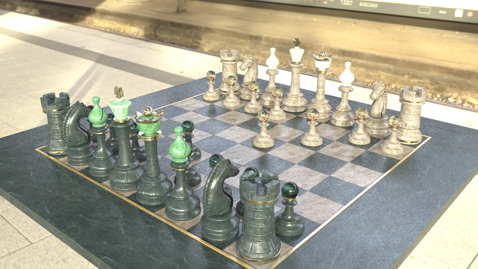
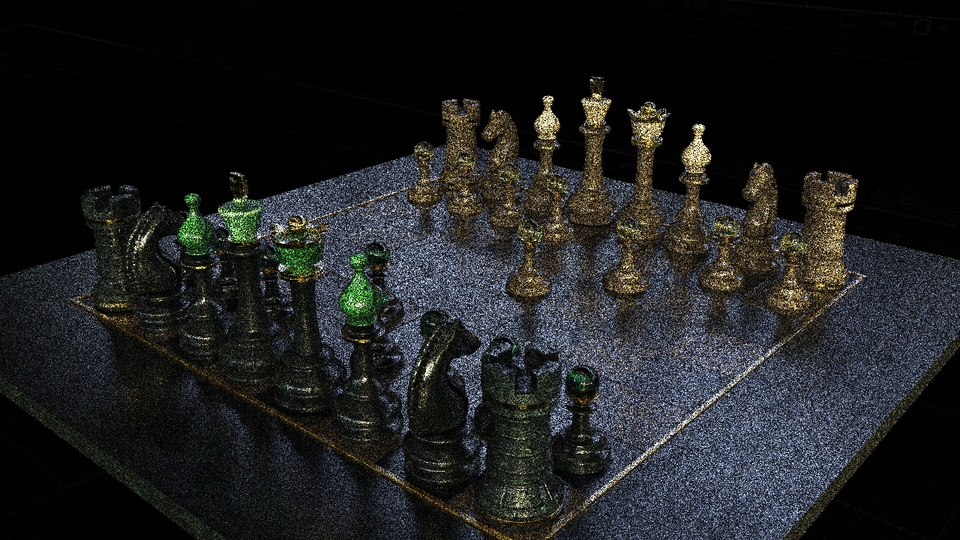
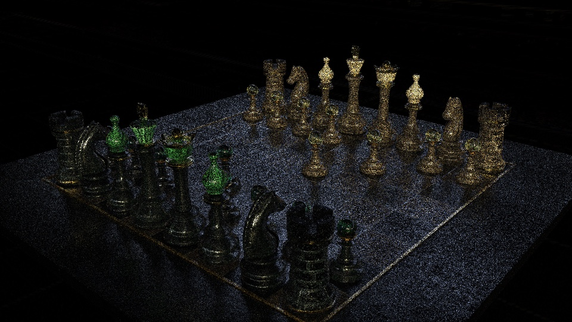

# Render devices: CPU, Metal and Vulkan

PrismRT renders through a *device*. Every device runs the same path tracer,
`shaders/integrator/path_tracer.h`, against its own backend:

| Device | Select with | Backend | Status |
| --- | --- | --- | --- |
| `metal` | `--device metal`, `PRISM_DEVICE=metal`, `prism:device` | HLSL kernel: DXC to DXIL, Metal shader converter; inline ray queries | macOS on Apple GPUs; ray-tracing hardware from M3 (M1/M2 run the same API in software) |
| `vulkan` | `--device vulkan`, ... | The same HLSL kernel, compiled to SPIR-V by DXC; `VK_KHR_ray_query` | Windows/Linux with NVIDIA RTX, AMD RX 6000+ or Intel Arc. Builds and compiles its kernel on macOS; not yet run-tested |
| `cpu` | `--device cpu`, ... | The same integrator compiled as C++, on Embree and the CPU materials (native MDL) | All platforms |

`auto` (the default) picks Metal on macOS and Vulkan elsewhere, and falls
back to the CPU device with a message when no GPU device is usable.
`PrismRT --list-devices` lists what this machine offers. (The former
`cpu-reference` device, the original recursive `SceneManager::trace`, was
removed; asking for it fails with "the cpu-reference device was removed; use
cpu".)

## How it fits together

- **One integrator.** [`shaders/integrator/path_tracer.h`](../shaders/integrator/path_tracer.h)
  is `PathTracer<Backend, Hit, Shading>`, written in the common subset of
  C++ and HLSL 2021 (structs without constructors, aggregate
  initialization, `(float3)x` for scalar-to-vector conversion, no swizzles,
  references or pointers; see `types.h`). The CPU device instantiates it with
  `CpuBackend` (`src/device/cpu_backend.h`; HLSL types and intrinsics for
  C++ come from `src/device/hlsl_math.h`), the GPU kernel
  (`shaders/gpu/kernel.hlsl`) with `GpuBackend`
  (`shaders/gpu/gpu_backend.hlsl`). Random numbers are drawn in the original
  order, so devices agree sample for sample up to floating-point and
  intersection differences. (The CPU device matched the former recursive
  integrator far below the noise floor.)
- **Explicit path state.** What a path carries between bounces is one
  struct, `PathState` (ray, sampler, radiance, weights, the previous
  vertex's MIS data, medium, depth and flags), advanced by step functions:
  `extend` (trace the segment, media, crossed lights, escape), then at a
  surface `chooseLight` (the next-event light sample), `backend.shade` (the
  material runs once: BSDF sample, BSDF towards the light, medium),
  `arrive` (emission, cutout crossings), `connectLight` (shadow ray) and
  `continuePath` (roulette, next segment). The light sample needs nothing
  from the material, so it is drawn first and one material invocation
  answers both the BSDF sample and the light evaluation; a cutout crossing
  rewinds the sampler to before the unused light sample. Random numbers are
  drawn in the original order: images are bit-identical to the single-loop
  integrator on the CPU and Vulkan devices.
- **One GPU kernel.** Metal and Vulkan compile the same HLSL; only
  `shaders/gpu/metal/resources.hlsl` (descriptor heaps) and
  `shaders/gpu/vulkan/resources.hlsl` (descriptor set bindings) differ.
- **GPU scene.** `src/device/gpu/gpu_scene.*` flattens a `SceneManager` into
  shared records (`shaders/shared/prism_gpu_types.h`): one bottom-level
  acceleration structure per prototype (triangles; analytic spheres as
  procedural boxes), one instance per placement, per-primitive materials, the
  built-in materials (the fallback `Diffuse`, `Emissive`) and their textures,
  and the environment with its importance
  tables.
- **MDL on the GPU.** `src/device/gpu/gpu_materials.*` compiles the scene's
  MDL classes again with the HLSL backend into one link unit, with a
  generated dispatch function per entry point. Materials keep their native
  argument blocks (the shading-language backends use the native layout);
  only texture indices are remapped. The MDL code comes from the SDK's HLSL
  backend for both devices. Classes that differ only in names
  (MaterialX node names become parameter names) share one program: the 15
  OpenChessSet materials compile as 4.
- **Programs translated alone.** While a Vulkan device exists
  (`gpu::AddProgramListener`), every MDL class is also translated with the
  HLSL backend by itself, on the material worker that compiled it, right
  after class compilation and before its native code and textures
  (`mdl::SetClassObserver`; about 0.15–0.4 s per class). Its code has its
  own texture indices, read-only data offsets and string ids, so it does not
  depend on the scene's other programs; these translations give the link
  unit's structural keys, and the callable path uses them directly (the
  *per-program layout*, `GenerateProgramShaderCode`): each material's
  `GpuMaterial.textures` names its program's read-only data and two tables in
  the read-only data buffer, one mapping the program's texture indices (and
  its argument block's) to the scene's, one its string ids to the scene's
  (primvar names). Only callables compiled from such code
  (`PRISM_MDL_PROGRAM_TABLES`) read the tables; the compute kernel, the
  link-unit callables and Metal are unchanged.
- **No SDK fork.** Apple GPUs lack FP64. `hlsl_fp32_rewrite.*` rewrites the
  generated HLSL to single precision; on FP64 test code its output is
  byte-identical to the `hlsl_disable_double` option of our MDL SDK fork.
- **Geometric outputs** (primary AOVs, picking) are traced on the CPU scene,
  which is exact and already present.

## Shader compilation and caches

GPU shading languages inline every call, so the kernel contains each
material's code once per call site; the integrator therefore calls every
material entry point from exactly one place, and the kernel entry calls
`renderSample` once. Even so, SPIR-V legalization of a kernel with many
materials needs more than the default 4M ids, so the Vulkan device passes
`-fspv-max-id` to DXC (the final module's ids are compacted).

If the Vulkan device cannot prepare a scene (its kernel fails to compile,
its resources do not fit), it prints the reason once and renders that scene
on the CPU device until the scene changes.

| OpenChessSet (4 MDL programs) | Time |
| --- | --- |
| First run: MDL codegen + DXC (`-Od`) + Metal shader converter + Metal pipeline | about 30 s |
| Later runs (metallib cached in `~/Library/Caches/PrismRT/metal`, pipeline in Metal's system cache) | about 1.2 s shader setup, 2.3 s scene setup in total |

The Vulkan device caches its SPIR-V the same way (`.../PrismRT/vulkan`, or
`PRISM_CACHE_DIR/vulkan`). Next to each kernel it keeps the driver's
pipeline-cache data (`<SPIR-V digest>-<pipeline cache UUID>-<vendor>-<device>-<driver version>.vkpc`),
so creating the pipeline does not depend on the driver's own shader cache,
which other applications share and may evict: an evicted 2 MB kernel took 8 s to
create on an RTX 4070 Ti, against 0.01-0.05 s from either cache. A driver
update or another GPU reads its own file; the driver checks the data header
again. Both files are written to a temporary name and renamed, so processes
sharing the cache directory never read a partial file. Uploaded textures
are reused across Hydra scene rebuilds.

## Material programs as callable shaders (Vulkan)

One inlined kernel stops compiling at about 1 MB of HLSL: DXC's SPIR-V
legalization of the single function needs more than 8 GB, and the NVIDIA
driver's compile of unlegalized SPIR-V more than 12 GB and 400 s. Below that
size it compiles, but slowly (OpenChessSet: 41 s cold) and, for all but the
smallest material sets, runs slower than separate programs. The Vulkan
device therefore does not inline the materials of most scenes; it builds a
ray tracing pipeline (`VK_KHR_ray_tracing_pipeline`,
`src/device/vulkan/vulkan_material_calls.*`):

- **Raygen shader.** `kernel.hlsl` compiled with `PRISM_CALL_MATERIALS`:
  the same integrator and step functions, built-in materials, lights and
  environment, but no MDL code. `GpuBackend::shade` packs a `MaterialCall`
  (`shaders/gpu/material_call.hlsl`) and calls the hit's MDL program with
  `CallShader(program, call)`; `cutoutOpacity` of a varying cutout does the
  same in its own mode. It depends on no scene (with reordering, on the
  hint bit count only), so the device compiles it in the background from
  its creation, while the first scene loads.
- **One callable per MDL program.** `shaders/gpu/vulkan/material_callable.hlsl`
  with that program's dispatch (`MdlShaderCode::programDispatch`) and only
  the functions of the scene's link unit it reaches (a top-level split of the
  generated HLSL, `LinkUnitTrimmer`; DXC would drop the others anyway, the
  SPIR-V is identical). The program's index is left out of its source (fixed
  function names and dispatch case: only that program reaches the callable),
  so a program compiles to the same callable in any material set whose
  link unit gives it the same code. It runs the megakernel's own code: the
  program's init on the prepared shading point, then `GpuBackend::shade`
  (BSDF sample, BSDF towards the light sample, medium). With the integrator's
  step functions that is one call per surface bounce. Programs whose
  generated code exceeds `PRISM_VULKAN_SPLIT_PROGRAM_KIB` (default 1536; the
  OpenPBR playground's transmissive programs, about 2.4 MB, against 0.7 MB
  for its opaque ones) are two callables instead, a sample part (init, BSDF
  sample, medium; also the cutout and emission queries) and an evaluate part
  (init, the BSDF evaluations), which the raygen shader calls only when the
  sample needs an evaluation (see the [driver compile
  budget](#driver-compile-budget)). Every program has two callable slots,
  `2 x program` and `2 x program + 1`; a whole program fills both with its
  one callable and answers `kMaterialCallEvaluated`.
- **Intersection stays in inline ray queries** inside the raygen shader, not
  `TraceRay`: the hit shading is the material, which is already a callable;
  the query loop (including the analytic sphere test) is the megakernel's,
  so both paths trace identical rays; and no hit groups, intersection
  shaders or payload for hits are needed. Shader execution reordering works
  without hit objects (a hint is enough).
- **Shader execution reordering** (opt-in, `PRISM_VULKAN_REORDER=1`). With
  `VK_NV_ray_tracing_invocation_reorder`, the raygen shader reorders threads
  by program (`OpReorderThreadWithHintNV`, hint bits for the program count)
  just before the call.
- **Compilation.** Each callable and the raygen shader is its own DXC run
  (`lib_6_6`, cached by source in the SPIR-V cache) and, with
  `VK_KHR_pipeline_library`, its own pipeline library, compiled by the
  driver right after its DXC run on the same thread: DXC of one shader
  overlaps the driver compile of others. Up to `PRISM_VULKAN_COMPILE_THREADS`
  shaders (default min(16, hardware threads)) compile at once, with up to
  `PRISM_DXC_JOBS` DXC processes (default half the hardware threads, at most
  12 and one per 2 GiB of memory; each capped by `PRISM_DXC_MEMORY_MIB`).
  The background raygen compile and its DXC run above normal priority.
  Libraries stay in memory for the device's life, each with its own
  `VkPipelineCache` file (`<SPIR-V digest>-lib-<pipeline cache UUID, device,
  driver>.vkpc`); a scene's pipeline links the raygen library and its
  programs' libraries (10–60 ms), so a new scene or an edited material set
  compiles only the callables the device has not seen. The pipeline compiles
  while the scene's buffers, images and acceleration structures upload.
  Without pipeline libraries (or `PRISM_VULKAN_PIPELINE_LIBRARIES=0`) the
  pipeline is created whole, as a deferred operation joined by worker
  threads, with one cache file per material set
  (`<digest>-<pipeline cache UUID, device, driver>.vkpc`).
- **Compiled while the materials load.** A program's callable source comes
  from its own translation (above), so it compiles before the scene is
  complete: as soon as the programs translated since the last scene make
  the compute kernel certainly too large (the estimate below above 1.15
  times the threshold, or `PRISM_VULKAN_CALLABLES=1`), each program's
  callable is queued for DXC and its pipeline library on background compile
  threads (`MaterialCallShaders::prefetch`; at most
  `PRISM_VULKAN_COMPILE_THREADS`, DXC limited as above), while other
  materials and textures are still being prepared. The scene's pipeline
  then links what is ready and waits for the rest (`reused=` in the
  `vulkan.pipeline` mark). The estimate is the kernel without MDL code plus
  the programs' target code with declarations they share counted once
  (`gpu::LinkUnitEstimate`); measured against the real link unit: chess 471
  vs 546 KB, jade egg 592 vs 575 KB, OpenPBR 2975 vs 2926 KB, parity 194 vs
  194 KB. Within 15% of the threshold the link unit decides as before (and
  a material set that ends up there uses the link-unit callables, compiled
  after the scene as before); compute-kernel scenes compile only once all
  materials are known.
- **Payload.** 47 words in (the shading point fields the MDL state and BSDF
  read, the BSDF sample point, the light direction, the RNG state) and 21
  out: 272 bytes through the callable's stack per call. A split program's
  sample part leaves its answer in the payload and its evaluate part adds
  the evaluations, so the raygen shader keeps nothing else live across the
  calls.
- **Fallback.** If the pipeline cannot be built, the scene renders on the
  CPU device as before.

When it is used (`PRISM_VULKAN_CALLABLES`): unset (`auto`), when the
assembled compute kernel is above `PRISM_VULKAN_CALLABLE_THRESHOLD_KIB`
(default 320), when DXC already failed to compile it within its memory limit
(the remembered `.too-large` marker), or when it fails that way now; `1`
always; `0` never. Kernels up to 320 KB carry little material code next to
the integrator (about 180 KB): the compute kernel then compiles about as fast
as the raygen shader alone and runs faster (CornellBox, 256 KB: 1.7x;
the test fixtures, 183–230 KB: up to 10%), while from the lion (392 KB, one
program) up every scene measured is faster with callables or within noise.
Devices without ray tracing pipelines use the compute megakernel, and the
CPU fallback for kernels too large for it.

Measured before pipeline libraries, trimmed callables and the size rule
(one monolithic pipeline per material set, callables forced), on an RTX
4070 Ti (driver 610.88, DXC 1.8), 960x540, 64 spp,
Hydra (`prism_hydra_render`). Chess and the eggs are forced through callables
(`PRISM_VULKAN_CALLABLES=1`) for comparison with the megakernel. Cold: every
shader compiled anew (`PRISM_VULKAN_SHADER_SALT`); warm: SPIR-V and pipeline
caches present. GPU times are the median pass time per run, averaged over 4
alternating runs (another process used the GPU meanwhile; runs it slowed by
over 1.5x are left out). Parity is against the CPU device with the same seed;
the noise floor is the CPU with seed 1 against seed 0.

| Scene (programs) | Cold setup: total (DXC wall, slowest, largest DXC; driver) | Warm setup | Callables ms/sample | Megakernel ms/sample (cold compile) | CPU ms/sample (approx.) | Mean ratio, NRMSE vs CPU (noise floor) | Callables vs megakernel |
| --- | --- | --- | --- | --- | --- | --- | --- |
| OpenPBR playground (35) | 26.4 s (15.2 s, 5.2 s, 440 MiB; 10.2 s, +820 MiB) | 1.0 s | 85.8 | does not compile | 660 | 0.9989, 0.075 (0.228) | — |
| Stirling (24) | 13.6 s (6.5 s, 2.7 s, 245 MiB; 6.9 s) | 0.4 s | 13.2 | does not compile | 56 | 0.9986, 0.034 (0.126) | — |
| MaterialEggs countertop (34) | 24.4 s (14.4 s, 4.5 s, 350 MiB; 9.1 s) | 1.1 s | 107.7 | does not compile | 560 | 1.0000, 0.027 (0.159) | — |
| OpenChessSet (5) | 8.7 s (2.2 s, 1.5 s, 136 MiB; 6.5 s) | 0.1 s | 23.4 | 45.5 (41 s) | 180 | 0.9982, 0.056 (0.157) | 1.00000, 0.0022 |
| Jade egg (7) | 8.4 s (1.9 s, 0.9 s, 79 MiB; 6.4 s) | 0.1 s | 22.3 | 26.7 (34 s) | 185 | 0.9998, 0.0015 (0.072) | 1.00000, 0.0007 |
| Brown egg (6) | 8.1 s (1.7 s, 1.1 s, 93 MiB; 6.4 s) | 0.1 s | 18.0 | 19.7 (26 s) | 180 | 0.9997, 0.0036 (0.066) | 1.00000, 0.0011 |
| Gold egg (6) | 7.7 s (1.3 s, 0.6 s, 55 MiB; 6.4 s) | 0.1 s | 18.0 | 18.1 (24 s) | 155 | 0.9998, 0.0024 (0.070) | 1.00000, 0.0006 |

- **Parity.** Callables reproduce the megakernel image (mean ratio
  1.00000, NRMSE 0.0006–0.002, float-level differences in the inlined
  code); against the CPU they stand exactly where the megakernel does. The
  0.1–0.2% darker mean on textured scenes (chess, Stirling, OpenPBR) is the
  GPU's mipmapped texture filtering, also seen with the megakernel. OpenPBR
  ran with the default texture budget (38 of 152 images at reduced
  resolution); its 8.7 GB of full-resolution textures do not fit next to the
  desktop on a 12 GB card and paging made it 2.7x slower. The fixtures
  (lights, emissive, linking, SSS furnace, parity, CornellBox, cutouts) match
  the megakernel the same way and are clean under `VK_LAYER_KHRONOS_validation`.
- **Speed.** The callable path is not slower than the megakernel on any
  scene that has both, and up to 2x faster (chess): the compute megakernel
  uses 168–255 registers per thread and spills 1.5–3.4 KB (driver
  statistics), while the raygen shader keeps only the integrator's state and
  each material runs with its own register allocation.
- **Compile cost.** DXC per callable takes 0.2–5 s and at most 440 MiB
  (the megakernel needed more than 8 GB); the driver compiles the pipeline on
  worker threads (Stirling: 16.5 s on one thread, 7 s on 25) and about 6 s of
  it is the raygen shader alone. Warm starts take 0.1–1.1 s.
- **Out-of-line table lookups: tried, reverted.** MDL's layered BSDFs call
  `prism_mdl_lookup_3d` at every layer; inlined, its copies make most of a
  layered program's code (Lion: 77 copies) and of DXC's SPIR-V legalization.
  `[noinline]` on it cut Lion's cold DXC from 23 s to 3 s (SPIR-V 2.4 to
  0.7 MB, DXC peak 1.6 GiB to 84 MiB) and the GPU-ready time from 30 to
  14 s, but on the NVIDIA 610.88 driver the OpenPBR playground's callable
  libraries then compiled 12 times slower (489 s summed, slowest 36 s,
  against 41 s and 3.3 s; ready 38 to 56 s), Teapot's and the damascus egg's
  3-3.6 times slower, the compute kernel's pipeline (CornellBox) 3.5 times
  slower. It also cost time per sample (warm, 960x540: Lion 14.1 to 23.0 ms
  per pass, Teapot 4.5 to 8.4, chess 29.0 to 33.5), and its images had
  non-finite pixels: every run at 16 spp (9 of 9; 1 of 3 at 4 spp), against
  none inlined. The finite images were bit-identical to inlined ones.
- **Inlined table lookups, rewritten.** The lookup stays inlined but is
  written for small inlined code: the three axes as vectors, wrap modes and
  crop checks as selects instead of loops and short-circuit conditions, no
  per-texel bounds checks (remapped texels always lie inside the table),
  one branch for the second and third components of RGB tables. Same
  arithmetic in the same order; the native runtime is unchanged. Lion's
  callable inlines to 161k SPIR-V instructions, 4.7k blocks and 22k locals
  (was 325k, 26k and 42k); DXC takes 2 s instead of 18-24 s (peak 137 MiB,
  SPIR-V 1.3 MB) and the driver 3.5 s instead of 4.6 s; GPU ready 31 to
  20 s. Every layered program gains (OpenPBR: DXC 76 to 29 s summed, driver
  34 to 25 s summed), as does the compute kernel's pipeline (CornellBox 3.6
  to 2.6 s). Time per sample is unchanged or lower (64 spp: Lion 7.7 to
  7.0 ms, Teapot 3.5 to 3.5, chess 21.5 to 21.2), images are bit-identical
  (one Teapot pixel differs by 1.5e-6) and free of non-finite values. See
  [performance.md](performance.md#bsdf-table-lookups).
- **Shader execution reordering** (hint by program, `PRISM_VULKAN_REORDER=1`)
  is off by default: 2–8% slower on OpenPBR, chess and the eggs, neutral on
  Stirling, 16% faster on the countertop. Reordering by program alone does
  not pay for itself; the countertop gains because its many programs
  interleave within warps.
- **Not measured:** occupancy and spills of the raygen and callables. The
  NVIDIA driver lists no executables for ray tracing pipelines
  (`VK_KHR_pipeline_executable_properties`), and Nsight Compute was not
  available.

### Driver compile budget

The driver compiles SPIR-V inside the process, and its memory grows with the
square of a module's size. NVIDIA 610.88 (RTX 4070 Ti), one library at a
time: 2 MB of SPIR-V took 5 s and 0.2-0.45 GB, 6.9 MB 44 s and 1.4 GB, 15 MB
125-134 s and 4.9-6.1 GB. The CLI render of the OpenPBR playground ended in
"LLVM ERROR: out of memory" from 179afa8 on: since the dielectric repairs
(f54d91d, a9c2287) its transmissive OpenPBR programs are 3.5 times larger
(tape: 2.7 to 9.5 MB of SPIR-V), since 4fed928 the CLI loads all 53 of its
materials (14 of them transmissive: 9.5-21 MB each), and the device
compiled 16 libraries at once. The emitter work of phase 5 was not involved
(the same sizes without it). The repairs themselves were not the cost but
how they were applied: they flattened the surface's graph into the material,
which made its internal constants (the scatter modes among them) class
parameters, and the CLI compiles classes unfolded. They now rewrite a
private copy of the graph ([MaterialX compatibility, private
graphs](materialx_compatibility.md#private-graphs)), and a thin wall with one
shader on both sides compiles its scattering once (the backface uses the
surface's function): every playground program is 1.9-2.2 MB again, whole
(below; Hydra, which folds the constants, was never affected). Four changes
keep the driver within bounds and the cold compile short:

- **One BSDF evaluation call site** (`GpuBackend::shade`). DXC inlines every
  call of a program's code; the light lobes' second evaluation made the
  callables 1.4 times larger (OpenPBR 21 to 15 MB, 9.5 to 6.9, opaque 2.7 to
  2.0). The light-sample and lobe evaluations now run in one loop.
- **Large programs split into two callables** (`MaterialCallPart`,
  `PRISM_VULKAN_SPLIT_PROGRAM_KIB`, default 1536 KiB of generated code; 0
  splits every program). The sample part (init, BSDF sample, medium, cutout
  and emission queries) and the evaluate part (init, BSDF evaluations) of
  OpenPBR's coupled glass are 9.0 and 6.0 MB of SPIR-V instead of 15 MB
  whole, estimated 2.1 and 1.1 GB to compile instead of 5.3 GB; its
  thin-film glass 4.2 and 2.7 MB instead of 6.9. The raygen shader calls
  slot `2 x program`, then `2 x program + 1` from the same call site only
  when a split program's sample needs an evaluation; the sample part leaves
  its answer in the payload. Images are bit-identical to whole programs
  (OpenPBR, the glass fixture with every program split). A split program
  runs the MDL init twice when it evaluates: OpenPBR at 640x360, 16 spp,
  took 0.96 s of GPU time against 0.83 s with whole programs (single runs).
  DXC's estimate for a part is 60% (sample) or 45% (evaluate) of the
  whole's: measured peaks 1027 and 724 MiB against 1740 MiB whole. Since
  the repairs use private graphs no playground program is above the
  threshold; the split stays as the safety net for materials that are large
  by themselves.
- **A compile memory budget.** Each driver compile (pipeline library,
  compute kernel; a monolithic pipeline compiles on one thread when its
  shaders together exceed the budget) and each callable's DXC process holds
  an estimate of its memory (`DriverCompileBytes`: 256 MiB + 24 MiB per
  square MiB of SPIR-V; `DxcCompileBytes`: 64 MiB + 260 MiB per square MiB
  of HLSL) and waits while the compiles running hold too much of
  `PRISM_VULKAN_DRIVER_MEMORY_MIB` (default a quarter of the memory the
  process may commit: physical memory, or its job's limit). A compile larger
  than the budget runs alone. DXC counts too: it runs in the same job.
- **A size limit before pipeline creation.** SPIR-V above
  `PRISM_VULKAN_MAX_SPIRV_MIB` (default 24), or whose estimated compile needs
  more than half of what the process may commit, never reaches the driver:
  the shader fails with "too large for the driver" and the scene renders on
  the CPU device (status `cpu (Vulkan fallback: shader too large for the
  driver)`). 0 disables the limit.

OpenPBR playground, CLI, 640x360, 16 spp, `--adaptive-threshold 0`, 32 GB
job cap (budget 8 GB). Cold (`PRISM_VULKAN_SHADER_SALT`): whole programs
(before the split, 24 GB cap, budget 6 GB) 22 callables, DXC and driver
1390 s (libraries 1453 s summed, slowest 128 s; the eight 15 MB programs
compile one at a time), 1468 s in all; split, 37 callables (8 opaque
programs whole, 14 transmissive split), 334 s (libraries 1299 s summed,
slowest 64 s; DXC 30 s at most, peak 1031 MiB), 412 s in all, of which
70 s are the scene load (USD, MDL, textures). Peak of PrismRT and DXC
together 18-20 GB. Warm (SPIR-V and pipeline caches present): shaders 1 s,
scene 3.7 s, 79 s in all. With the pipeline caches but not the SPIR-V
cache (a shader source change that leaves the SPIR-V unchanged): 78 s of
DXC. The image is bit-identical to the whole programs' (against the CPU:
NRMSE 0.32, mean 0.42%; noise floor 0.46, 0.42%).

With the repairs in private graphs (same scene and settings; caches of
textures and MDL warm, shaders cold through the salt): 22 programs of
1.9-2.2 MB of SPIR-V (generated code 0.7-0.75 MB, below the split
threshold, so every program is one callable), DXC 7 s at most, libraries
13.7 s at most and 244 s summed, shaders 35 s, 76 s in all (scene load
35 s). Warm: shaders 0.3 s, 41 s in all; 16 samples took 0.66 s of GPU time
(0.83 s with the whole inflated programs, 0.96 s split). Peak private bytes
of the process 12.3 GB (warm). The Hydra delegate (`prism_hydra_render`, 37
folded programs) took 31 s cold and 13.7 s warm, as before the change; at
979c870, before the repairs, 23 s cold: the rest is the raygen shader with
`PRISM_VARYING_EMITTERS` (phase 5), compiled once the scene's programs are
known (13.5 s in the driver) because the prewarmed raygen lacks it. (Fixed by the raygen prewarm below.)
`PRISM_GPU_PROGRAM_REPORT=1` makes the CLI print, after loading the scene,
the layout, program count and each shader's HLSL and SPIR-V size, DXC time
and estimated driver memory (DXC only, no device), and exit; the Hydra
delegate does the same when it would prepare its device (run it with
`PRISM_DEVICE=cpu`, e.g. through `prism_hydra_render`);
`prism_gpu_program_budget_test` checks the same on
`tests/hydra/fixtures/textured_emitters_glass.usda`.

### Raygen prewarm

The device compiles the scene-independent raygen shader while the scene's
materials still load (`MaterialCallShaders::prewarmRaygen`). Scenes with
textured (varying) emitters need the variant compiled with
`PRISM_VARYING_EMITTERS`, which the plain prewarm does not cover. A program
whose emission is not provably uniform (`MDLMaterial::evaluateUniformEmission`'s
rule, applied to the `CompiledProgram` in `src/mdl/backend_compiler.cpp` as
the class compiles) and each `MDLMaterial` that classifies as a varying emitter
(`variesEmission()`, for emission that is uniform per program but not per
binding) call `prism::varying_emitters::Note()` (`src/varying_emitter_signal.h`);
the Vulkan device subscribes, and on the first note (or at creation, if a note
came earlier) it prewarms the variant with the define as well. The plain raygen is
still prewarmed at device creation, so a scene with emitters compiles both in
the background; a scene without emitters compiles only the plain one. Both are
the exact sources of the scene's raygen shader (no reordering, no light AOVs),
so the shader cache keys are those of the later compile.
`PRISM_VULKAN_PREWARM_EMITTERS=0` turns the early variant off.
`PRISM_GPU_PROGRAM_REPORT=1` prints `raygen_prewarm plain|plain+emitters
covers_scene <0|1>`; `prism_raygen_prewarm_test` checks that a textured
emitter scene notes and a scene without one does not.

## Mac GPU vs CPU

Apple M5 (10 CPU threads, 8 GPU cores), macOS 26. Times are the renderer's
`renderSeconds` with warm shader caches; for the GPU they include the scene
upload. "Noise floor" is the CPU against itself with another seed: a GPU
difference below it is sampling noise, not bias.

| Scene | Size, spp | CPU | Metal | Speed-up | Metal vs CPU NRMSE | Noise floor NRMSE | Mean luminance difference |
| --- | --- | --- | --- | --- | --- | --- | --- |
| OpenChessSet, standalone | 1280x720, 256 | 221.3 s | 21.4 s | 10.4x | 0.068 | 0.109 | 0.02% |
| OpenChessSet, Hydra | 1280x720, 256 | 221.9 s | 16.9 s | 13.2x | 0.068 | — | 0.003% |
| CornellBox | 640x360, 128 | 28.6 s | 1.5 s | 18.8x | 0.036 | 0.118 | 0.05% |
| QuadTest | 640x360, 128 | 11.0 s | 1.1 s | 10.4x | 0.0001 | 0.017 | 0.00002% |
| InOneWeekend (485 analytic spheres) | 640x360, 128 | 31.1 s | 11.3 s | 2.7x | 0.015 | 0.042 | 0.01% |
| Parity fixture (environment map) | 256x256, 256 | 9.2 s | 3.1 s | 3.0x | 0.00008 | 0.010 | 0.00005% |
| Hydra fixtures (instances, preview, bindings) | 256x256, 128 | 0.6–5.3 s | 0.5–2.4 s | 0.7–10x | ≤ 0.019 | — | ≤ 0.03% |

The OpenChessSet scene is lit only by the Poly Haven `hamburg_hbf` 4K
environment map (`local/chess/chess_scene.usda`).

| CPU | Metal |
| --- | --- |
|  |  |
| CPU seed 0 vs seed 1, x4 | Metal vs CPU, x4 |
|  |  |

The Metal difference is darker than the CPU's own seed-to-seed noise and
shows no structure. Remaining differences come from single-precision camera
rays, GPU mipmapped texture filtering against OIIO's anisotropic filtering,
and hardware intersection.

Notes:

- Small scenes are dominated by the fixed GPU scene setup (about 1–2 s); the
  speed-up grows with image size and sample count.
- Analytic spheres are procedural primitives tested in the ray-query loop,
  which Apple's hardware traverses slower than triangles (InOneWeekend).

Reproduce with `local/baseline/compare_gpu.sh <output dir>` (local, untracked
setup; see `prism_env.sh`).

## Sampling

Everything below lives in the shared integrator (`shaders/integrator/`), in
the C++/HLSL subset, so the CPU, Vulkan and Metal devices draw the same
numbers in the same order and agree sample for sample.

- **Sample points.** `Sampler` (`types.h`) hands out 4-D points:
  Owen-scrambled Sobol (Burley 2020) indexed by the sample number, with a
  per-pixel seed and a separate index shuffle and scramble for each 4-D
  group, so any sample index works in progressive rendering. The first four
  groups are Sobol (camera pixel and lens, the first BSDF sample, the light
  selection, the light sample); later ones are hashed random points.
  Materials and cutouts keep the pixel's LCG. Numbers stay on a 24-bit grid
  in (0, 1): zero becomes 2^-25, because MDL's layered BSDFs pick a
  zero-weight lobe for xi exactly 0 and divide by its probability.
- **Next-event estimation** at every scattering vertex, with power-heuristic
  MIS against BSDF sampling for every light type. Probabilistic NEE
  (`prism:neeProbabilityMin`) is off by default.
- **Light selection.** An alias table over the light table picks by power
  (analytic lights, constant-emission triangles, triangles of varying
  emission by their estimated power, the dome as one entry). Tables of more
  than 4096 entries draw the column and the alias choice from the white
  noise (uniform columns by rejection): the selection number's 24-bit grid
  reached each column of a million-entry table only ~18 times, and the
  realized probabilities strayed from the table's (the dome of a
  million-triangle table came out 0.958 for 0.99; the OpenPBR playground's
  desk was lit 8% too brightly; `prism_lights_test`).
  With `prism:lightSelection spatial` (default) and 2 to 64 analytic lights,
  an analytic pick is redone among the analytic lights in proportion to
  `lightImportance` at the shading point: radiance times the solid angle
  the light subtends, zero behind one-sided planar lights, inside spheres
  and cylinders, and for lights not linked to the receiver. Triangles and
  the dome keep their probabilities. BSDF hits on a light recompute its
  selection probability from the vertex that scattered the ray (not the ray
  origin, which moves at cutout crossings). Shaped lights (UsdLuxShapingAPI)
  multiply it by a bound on their shaping over the directions the light
  subtends at the point (zero outside a cone, exact for points), and their
  power-table weight by the fraction of power their shaping leaves.
- **Shapes.** Spheres: uniform cone. Rects: uniform solid angle (spherical
  rectangles, Urena et al. 2013) above 1e-3 sr, area below. Cylinders: the
  arc visible from the shading point, equiangular along the axis. Disks and
  triangles: area. Distant lights: cone. Dome: texel alias table.
- **Emissive triangles of varying emission** (`kLightVaryingEmission`;
  [feature_roadmap.md](feature_roadmap.md), "Textured emission as lights"):
  the light sample asks the backend for the emission at the sampled point
  (`backend.emitterRadiance`): the CPU builds the hit Embree would report and
  runs the material; the GPU builds it with `gpu_hit_from_raw` and runs the
  emitter dispatch (`prism_mdl_*_emitter`, programs of such materials only)
  in the compute kernel, or calls the program's callable with
  `kMaterialCallEmitted`. The lookup uses the footprint of the BSDF ray in
  that direction (`spawnRay`), so next-event estimation and BSDF hits see
  the same filtered textures; with an empty footprint the far floor of the
  checker fixture came out 6 to 10% bright. BSDF hits take each triangle's
  own density from `GpuInstance.emitters` (per-primitive densities after the
  primitive material tables) or `LightTable::varyingEmitters`.
- **Russian roulette** from `prism:rrMinDepth` (4) with survival
  clamp(path weight, 0.05, 0.95).

Measured on Vulkan at 256x256 against 32768-spp references, sample clamp off,
RMS over 4 seeds (before: the integrator before these changes, with
probabilistic NEE and power selection):

| Scene | NRMSE 64 spp before → after | NRMSE 256 spp before → after | Time per sample |
| --- | --- | --- | --- |
| CornellBox (small area light) | 0.0101 → 0.0088 | 0.0045 → 0.0038 | +2% |
| `tests/hydra/fixtures/lights.usda` (5 UsdLux lights) | 0.224 → 0.053 | 0.113 → 0.027 | +2% |
| Large rect light near a ball and floor | 0.106 → 0.080 | 0.053 → 0.040 | +3% |
| MaterialEggs jade egg (dome, subsurface) | 0.118 → 0.116 | 0.062 → 0.061 | +9% |
| OpenChessSet (dome) | 0.147 → 0.151 | 0.080 → 0.081 | +1% |

Relative mean luminance stays within 0.05% of the references. Where the
noise came from (64 spp): on CornellBox, 77% from light that bounced at least
twice, 23% from directly visible edges and the light, under 1% from direct
light; on the lights fixture, 89% from direct light, nearly all of it on the
wall next to the tube light; on the egg and the chess set, roughly 45% direct
and 55% indirect. Always sampling lights costs the egg and the chess set a few
percent of efficiency (the egg's random walks leave through many vertices);
`prism:neeProbabilityMin 0.05` restores the previous behavior.

Tried without a measurable gain: Sobol points for all dimensions or for 8 or
16 groups (within 2%), packing the light selection into the light sample's
group, and Russian roulette from depth 2 (worse) or 8 (CornellBox -14% MSE,
OpenChessSet +18% time). Pixel filters other than the box were not tried:
they change the image, not just its noise.

## Vulkan memory placement

`VulkanDevice::Impl::upload` (`src/device/vulkan/vulkan_device.cpp`) places
each storage-buffer slot by who touches it after the upload:

- **Host-visible**, always: the frame parameters, the pixel list, the RNG,
  the output and the accumulation (the host writes or reads them every
  dispatch; the last three host-cached), and the image records
  (`kSlotImages`, which texture streaming rewrites in place).
- **Read-only scene slots** (positions, normals, texcoords, tangents,
  indices, prototypes, instances, primitive materials, materials, legacy
  textures, spheres, environment and its alias tables, lights and their
  alias table, primvars, MDL argument blocks, read-only data, texture
  records and tiles, BSDF data; only the kernels and the AS builds read
  them) go where `ensureScene`'s `choosePlacement` says, for the whole
  scene, in this order:
  1. **ReBAR** — a `DEVICE_LOCAL | HOST_VISIBLE | HOST_COHERENT` memory type
     on the largest device-local heap (RTX 4070 Ti / Windows: type 4, heap
     0; the 256 MiB BAR window that drivers without resizable BAR expose is
     a heap of its own and does not count). The host maps the buffer and
     `memcpy`s into it, exactly as into system memory; no copy commands or
     barriers: host writes to host-coherent memory made before a queue
     submission are visible to that submission's commands (the submission's
     implicit host-write memory dependency).
  2. **Staging copies** (no ReBAR) — a `DEVICE_LOCAL` buffer filled from a
     host-visible staging buffer by one batch of `vkCmdCopyBuffer`
     (`flushUploads`), then a transfer-write → all-commands memory barrier,
     before the images, the AS builds and any dispatch; the staging buffers
     go once that submission's fence signals.
  3. **Host-visible** system memory, as before (the first
     `HOST_VISIBLE | HOST_COHERENT` type: type 2, heap 1 on the 4070 Ti).
     Also the fallback of any slot whose device-local (or staging)
     allocation fails.
- **One budget with the textures.** By default (`auto`) the scene slots
  take device-local memory only when, after them and an estimate of the
  acceleration structures built from them (the positions' and indices'
  size), the heap's `VK_EXT_memory_budget` budget still holds the rest of
  the texture budget (`prism:gpuTextureBudgetMiB`, by default 45% of the
  heap; resident images count once). Otherwise they stay in system memory
  (`gpu::SceneBuffersFit`, `src/device/gpu/texture_budget.h`). Textures
  never shrink for the buffers: the texture budget, and so every image, is
  the same whatever the placement, which changes only where shading reads
  its data from. Without `VK_EXT_memory_budget`, `auto` keeps them in
  system memory. A scene edit re-uploads every slot the same way
  (`ensureScene` runs after `vkDeviceWaitIdle`); the device's own
  device-local scene buffers are counted as freed.
- **`PRISM_GPU_SCENE_BUFFERS`** = `auto` (default, above) | `device`
  (ReBAR or staging, ignoring the budget) | `staging` (staging copies even
  with ReBAR; for testing) | `host` (system memory, the behavior before
  device-local placement). `PRISM_GPU_VERBOSE=1` prints the decision
  (`scene buffers N MiB (+M MiB for structures), A MiB available, texture
  budget T MiB (R resident): device-local|host memory`) and the result
  (`N scene buffers (X MiB) in device-local memory (ReBAR, written
  directly|staging copies|none: host memory)`).

Before this, every slot used the first `HOST_VISIBLE | HOST_COHERENT` type,
which on NVIDIA/Windows (RTX 4070 Ti, driver memory types 0-4) is type 2 in
the system-memory heap, so every shading read on an L2 miss crossed PCIe.
Measured on that machine (ReBAR, `auto` against `host`, 3 alternating
rounds, `--adaptive-threshold 0`, images bit-identical): OpenChessSet
(`local/chess/chess_scene.usda`, 1280x720, 256 spp) render 6.7 s against
12.7-14.7 s (0.52x; buffers 298 MiB of VRAM); MaterialEggs countertop
(640x360, 512 spp) 23.2 s against 24.3-29.1 s (0.91x; 1562 MiB). With
`--gpu-texture-budget-mib 64` the countertop's streamed textures are
reduced identically in both modes (0.86x); with a 10000 MiB texture budget
`auto` keeps the buffers in system memory.
Metal's buffers are shared
storage on unified memory and are unaffected.

## Metal checklist

Changes to code the Metal device shares, to verify on a Mac (build, then the
listed runs on `--device metal` against `--device cpu`) before the change is
called done there.

- **Shared core library** (SDK step 6, [sdk_design.md](sdk_design.md)):
  `prism` and `prism_usd` are shared libraries with hidden default
  visibility; only `PRISM_API`/`PRISM_INTERNAL_API` (and the USD ones)
  symbols are visible. Not built on macOS yet. Check on the Mac:
  - Build: `libprism.dylib` and `libprism_usd.dylib` link; no undefined
    symbols in `hdPrism` (a missing `PRISM_INTERNAL_API` shows as a link
    error, as on Windows). The Metal device (`src/device/metal/*.mm`) is in
    the core; nothing outside it calls into it, so it needs no exports.
  - Run time: `otool -L build/hydra/plugin/hdPrism.dylib` lists
    `@rpath/libprism.dylib`; `otool -l` shows an `LC_RPATH` that finds it
    from the build tree, and after `cmake --install` from
    `lib/usd/plugins/prism/plugin` (the install rpath is
    `@loader_path/../lib`, which does not reach `<prefix>/lib` from there:
    add `@loader_path/../../../../lib` or install the dylibs beside the
    plugin). usdview loads the plugin and renders on Metal.
  - `prism_single_runtime_test` skips (Windows PE checks); instead check
    with `nm -gU libprism.dylib | grep SharedMdlContext` and that
    `nm hdPrism.dylib` has no `SharedMdlContext` definition.
  - `catch (prism::Error const&)` in a client works (typeinfo is exported
    with the class, anchored by its destructor).
- **Colour management** ([color_management.md](color_management.md)):
  - Build: OpenColorIO 2.6 must be found (`find_package(OpenColorIO CONFIG)`;
    Homebrew's `opencolorio` or vcpkg), and `prism` (formerly `prism_core`) links it.
  - Shared shader code: `SampleSettings::luminance` (a `float3`) and
    `lightImportance(light, p, luminance)` in `shaders/integrator/`,
    `GpuFrame::color` (a `float4` appended to `shaders/shared/prism_gpu_types.h`,
    filled by `GpuRenderDevice::BaseFrame`, read in `shaders/gpu/kernel.hlsl`).
    No new binding; check the Metal frame buffer still matches `sizeof(GpuFrame)`.
  - Shared host code: `src/device/light_table.h`, `src/environment.h`,
    `src/lights.h`, the texture service's texel conversion
    (`src/texture_service.cpp`), the MaterialX generator's colour transforms
    (`src/materialx/mdl_generator.cpp`, `prepared_template.h`, `loader.cpp`),
    `src/hydra/scene_bridge.cpp` and `task_delegate.cpp`.
  - Runs: `ctest -R prism_color` (CPU), then
    `tests/hydra/fixtures/color_management.usda` with `prism_hydra_render
    ... --working-space acescg` on Metal and `prism_color_management_test
    --check-patches <exr> acescg`; an egg and OpenPBR on Metal vs CPU with
    `prism_compare_images`.
- **Failed image renders are errors** (`GpuRenderDevice::RenderImage`, shared
  by Vulkan and Metal): a scene that cannot be prepared, or a failed dispatch,
  throws with the sample, resolution and cause instead of returning the zeroed
  image, so the CLI exits 1 and writes nothing. `PRISM_GPU_FAIL_DISPATCH_AT=N`
  simulates a failure at sample N. Run: `PRISM_GPU_FAIL_DISPATCH_AT=0
  PrismRT --device metal ...` exits 1 with "GPU render failed at sample 1"
  and no output file (`prism_cli_gpu_failure_vulkan` is the Vulkan test).
- **Render settings and products** ([hydra.md](hydra.md#render-settings-and-products)):
  - No shader or device change: `shaders/` and `src/device/` are untouched.
  - Shared host code: `src/hydra/plugin.cpp` (the
    `HdsiRenderSettingsFilteringSceneIndex` in the chain),
    `src/hydra/task_delegate.cpp` (the active settings prim),
    `src/hydra/scene_bridge.cpp` (material binding purposes, the AOV table of
    `src/output/aov.h`), `src/output/` (resolver and image writer, also used
    by the CLI) and `src/mesh/usd_mesh.h` (binding purposes).
  - Runs: `ctest -R "prism_parity|prism_render_"` (CPU); then
    `PRISM_DEVICE=metal prism_hydra_render tests/hydra/fixtures/render_products.usda
    --render-settings default out-metal` against the same with
    `PRISM_DEVICE=cpu`, comparing each product with `prism_compare_images`
    (`--layer Normal --exact` for the geometric layer); and in usdview,
    `render_settings_binding.usda` turns from green to red when the render
    settings menu picks `/Render/AllPurpose`.
- **Free cameras with an unbounded far clip** (`src/hydra/pass_camera.h`,
  `src/hydra/scene_bridge.cpp`): host-side camera handling only, no shader or
  device change. On the Mac, `prism_hydra_pass_camera_test` (CPU) and a
  `SetCameraState` render with a far clip of 1e30 on `PRISM_DEVICE=metal`
  converging without restarting.
- **Scene features** ([hydra.md](hydra.md#scene-features)):
  - Shared shader code:
    - `shaders/integrator/path_tracer.h`: a camera ray that sees a
      camera-visible light covers its pixel; the light-lobe paths
      (`lobes`, `lobeScale`, `LightConnection::radianceSpecular`,
      `PathState::previousDiffuse`, `backend.lightLobes()` /
      `environmentLobes()`).
    - `shaders/integrator/types.h`: `BsdfEvaluation::diffuse`,
      `MaterialQuery::lobes`, `MaterialResult::sampleDiffuse`, `EnvironmentLobes`,
      `SurfaceHit::instanceRecord`; `lights.h`: `LightRecord::lobes` (one more
      `float4`: 112-byte records; check the Metal light buffer stride).
    - `shaders/shared/prism_gpu_types.h`: `kFrameLightLobes`,
      `kMaterialPrimvarColor/Opacity`, `kPrimvarComponents/Display*` (role bits
      in `GpuPrimvar.info.y`), `kInstanceCullBackFaces`,
      `kPrimitiveMaterialMask/CullBackFace` (bit 31 of primitive material entries),
      `GpuEnvironment.selection.yz` (dome multipliers), `GpuInstance.links.zw`
      (per-instance primvars).
    - `shaders/gpu/gpu_backend.hlsl` (fallback display primvars, BSDF diffuse
      parts, `environmentLobes`, masked material index), `geometry.hlsl`
      (`gpu_culled_triangle` in both ray queries), `mdl_runtime.hlsl` (instance
      primvars first in `prism_primvar`), `mdl_types.hlsl` (`primvar_instance`),
      `material_call.hlsl` (Vulkan callables only: payload 48 words in, 24 out).
  - Device code: `src/device/metal/metal_device.mm` sets
    `MTLAccelerationStructureInstanceOptionNonOpaque` on instances with
    `kInstanceCullBackFaces` (Vulkan: `FORCE_NO_OPAQUE`); untested, check that
    it compiles and that the ray query then sees their triangles as
    candidates. Shared host code: `src/device/gpu/gpu_scene.cpp`,
    `gpu_device.cpp`, `light_table.h`, `src/scene.h`, `src/environment.h`,
    `src/hydra/*`.
  - Runs: `ctest -R "prism_parity|prism_scene_features"` (CPU); then on Metal vs
    CPU, each fixture of [Scene features](hydra.md#scene-features) with the
    CLI (`--device metal`; `double_sided.usda` with `--render-settings
    /Render/Settings`) and `instance_primvars.usda` with
    `PRISM_DEVICE=metal prism_hydra_render`, checked with
    `prism_scene_features_test` and `prism_compare_images`; then chess and an
    egg (light lobes off: unchanged).
- **glTF materials as MaterialX** ([gltf.md](gltf.md)):
  - No shader or device change: glTF materials are ordinary
    `MDLMaterial`s. Shared host code: `src/mesh/gltf_mesh.h`
    (V-flipped UVs, `TEXCOORD_1`/`COLOR_0` mesh primvars, `single_sided`),
    `src/materialx/gltf_material.cpp`, `cached_document.h`,
    `PublishMaterialResourceBytes` in `resolved_resource.h`, and
    `LayerGltfPbrVolume` in `src/materialx/loader.cpp` (the absorbing medium
    reaches the device as for OpenPBR glass).
  - Runs: `ctest -R prism_gltf -LE gpu` (CPU); then with `--device metal`,
    the arguments of the `prism_gltf_*_vulkan_render` tests (spheres,
    textured) compared with their CPU renders by `prism_compare_images
    --tolerance 0.1 --mean-tolerance 0.02` (Vulkan: NRMSE 0.0002 and 0.0095),
    and `volume_sphere.gltf` checked with `prism_gltf_material_test
    --check-volume`. The textured fixture exercises Metal's MDL scene data
    lookups (`TEXCOORD_1`, `COLOR_0`) and sampler wrap modes.
- **Legacy glTF materials removed** (`gltfPBR`, `DiffuseGltf`, `MetalGltf`,
  `SpecularBTDFglTF`; [gltf.md](gltf.md#materials-that-fail)):
  - Shared shader code: `shaders/gpu/gpu_backend.hlsl` loses the
    `kMaterialDiffuseGltf`, `kMaterialMetalGltf`, `kMaterialSpecularBtdfGltf`
    and `kMaterialGltfPbr` branches of `gpu_legacy_sample`;
    `shaders/shared/prism_gpu_types.h` drops those constants (7 to 10; the
    other kinds keep their values, `kMaterialFallback` stays 11). Check that
    the Metal shaders still compile (nothing Metal-specific referenced them).
  - Shared host code: `src/device/gpu/gpu_scene.cpp` no longer translates
    them; a glTF material that fails now uses `ErrorMaterial`
    (`src/material.h`), an `Emissive` the GPU scene translates as
    `kMaterialEmissive` (magenta, not a light).
  - Runs: `ctest -R prism_gltf -LE gpu`; then on Metal the glTF runs above,
    and `metal_rough_spheres.gltf` with `PRISM_MATERIALX_LIBRARY_PATH` unset
    (the arguments of `prism_gltf_error_material_render`, `--device metal`)
    checked with `prism_gltf_material_test --check-error-material`.
- **OBJ/MTL materials as MaterialX** ([obj.md](obj.md)):
  - No shader or device change: MTL materials are ordinary `MDLMaterial`s
    (`open_pbr_surface`). Shared host code: `src/mesh/obj_mesh.h` (MTL
    statement scan, map publishing and TGA/BMP transcoding),
    `src/materialx/obj_material.cpp` (the converter; `bump` becomes four
    texel-shifted `image` lookups and arithmetic nodes, a pattern the GPU
    MDL backends had not compiled before).
  - Runs: `ctest -R prism_obj -LE gpu` (CPU); then with `--device metal`, the
    arguments of `prism_obj_textured_vulkan_render` compared with
    `textured_cpu.exr` by `prism_compare_images --tolerance 0.1
    --mean-tolerance 0.02` (Vulkan: NRMSE 0.0032), and the glass and
    emissive fixtures checked with `prism_obj_material_test --check-glass` /
    `--check-emissive` on Metal renders.
- **Hard-coded scenes and their materials removed** (`Metal`, `Glass`,
  `Dispersive`, the analytic `Quad` and `Box`, normal textures):
  - Shared shader code: `shaders/gpu/gpu_backend.hlsl` loses the
    `kMaterialMetal`, `kMaterialGlass` and `kMaterialDispersive` branches of
    `gpu_legacy_sample` (and `gpu_glossy_sample`, `gpu_dielectric_direction`,
    `gpu_refract`, `gpu_schlick`, `gpu_reflect`), the normal-texture block of
    `prepare` (`kMaterialNormalTexture`), and the quad case of the hit
    (`kProtoQuads`: primitive halving and the quad (u, v)).
    `shaders/shared/prism_gpu_types.h` drops those constants; the remaining
    ones keep their values, and `GpuMaterial.textures2` stays (unused) so the
    buffer layout and stride are unchanged.
  - Device code: `src/device/metal/metal_device.mm` builds triangle geometry
    with `proto.info.w` triangles (no quad doubling); the Vulkan device
    likewise. Shared host code: `src/device/gpu/gpu_scene.cpp` (no quad
    prototypes, no Metal/Glass/Dispersive translation),
    `src/device/light_table.h` (emissive triangles only).
  - Runs: the Metal shaders compile; `ctest -R "prism_parity|prism_scene_features"`
    on the CPU, then on Metal the `glass_furnace.usda` and
    `display_color_interpolation.usda` fixtures with the CLI (`--device
    metal`) against their CPU renders (`prism_compare_images`), and chess and
    an egg (unchanged: no shape or material they use was touched).
- **`cpu-reference` device removed** (`SceneManager::trace` and its helpers):
  - Shared shader code: comments only (`shaders/integrator/path_tracer.h`,
    `types.h`, `gpu_backend.hlsl` no longer name the removed functions); no
    code change. Shared host code: `src/hydra/scene_bridge.cpp` and
    `task_delegate.cpp` reject `PRISM_DEVICE` / `prism:device`
    `cpu-reference` with "the cpu-reference device was removed; use cpu"
    (`RemovedDeviceMessage`, `src/device/device.cpp`).
  - Runs: `prism_device_selection_test` on macOS (Metal is still preferred by
    `auto`; `cpu-reference` is rejected), and `PRISM_DEVICE=cpu-reference`
    in usdview warns once and keeps `auto`.
- **The CLI's USD loader at the delegate's level** (phase 7,
  [feature roadmap](feature_roadmap.md#standalone-cli)):
  - No shader or device change: `shaders/` and `src/device/` are untouched.
    The CLI's scenes now reach the GPU scene (`src/device/gpu/gpu_scene.cpp`)
    as the delegate's do: a placement per gprim, prototypes behind Embree
    instances with placement transforms (mirrored ones flip their
    orientation), per-placement materials (GeomSubsets), instance primvars
    (`GpuInstance.links.zw`) and light/shadow link masks.
  - Shared host code: `src/hydra/scene_bridge.cpp` (mesh conversion,
    displacement and the subdivision budget moved to
    `src/mesh/mesh_conversion.{h,cpp}`, unchanged), `src/hydra/materials.cpp`
    (the UsdPreviewSurface rewrite and `AddDisplacementShader` moved to
    `src/materialx/preview_surface.h`, unchanged), `src/scene.h`
    (`attachImportedMesh`), `src/output/aov.h` (id AOVs in both frontends).
  - Runs: `ctest -R "prism_parity|prism_scene_features|prism_obj" -LE gpu`
    (CPU); then on Metal the CLI (`--device metal`) on `instances.usda`,
    `instance_primvars.usda`, `linking.usda`, `mesh_features.usda`
    (`--render-settings /Render/Default`), `displacement.usda` and
    `implicit_surfaces.usda` against `prism_hydra_render` on the CPU with
    `prism_compare_images` (the `prism_parity_instance_primvars_vulkan_match`
    tolerances), and chess and an egg on Metal against the CPU.
- **Textured emitters as lights** ([Sampling](#sampling); Metal runs the
  compute-kernel path):
  - Shared shader code: `shaders/integrator/lights.h`
    (`kLightVaryingEmission`, `kLightSwappedVertices`, sampleLight's triangle
    `texcoord` = barycentrics, `primitiveBarycentrics`),
    `shaders/integrator/path_tracer.h` (chooseLight calls
    `backend.emitterRadiance` with `spawnRay(...)`'s footprint),
    `shaders/shared/prism_gpu_types.h` (`GpuInstance.emitters`, one more
    `uint4`: 144-byte instances; check the Metal instance buffer stride and
    that `metal_device.mm` uploads `d.instances` whole),
    `shaders/gpu/gpu_backend.hlsl` (`gpu_hit_from_raw` split out of
    `gpu_intersect`; `gpu_mdl_emitter_emission`, `gpu_mdl_emitter_radiance`;
    `GpuBackend::emitterRadiance`; `emitterPdfArea` reads the per-primitive
    densities stored as float bits in the primitive material table),
    `material_call.hlsl` / `vulkan/material_callable.hlsl` (Vulkan callables
    only: `kMaterialCallEmitted`).
  - Shared host code: `src/device/light_table.h` (estimate, records,
    `SceneHasEmitters`), `src/device/gpu/gpu_scene.cpp` (record placement →
    instance index, density tables), `src/device/gpu/gpu_materials.cpp`
    (`prism_mdl_*_emitter` dispatch; persistent program cache `v2`,
    structural keys `v4`), `src/mdl/backend_compiler.cpp`
    (`emission_zero`, `backface_emission`), `src/mdl_material.h`,
    `src/material.h`.
    `shaders/integrator/path_tracer.h` also picks lights of tables over 4096
    entries with the white noise (`pickLight`, `kPreciseLightPickEntries`).
    Kernels of material sets with varying emission are compiled with
    `PRISM_VARYING_EMITTERS` (from the generated MDL code; the Vulkan raygen
    shader gets it from `RaygenSource`), the others leave the light-sample
    emission out, so their code and images are unchanged.
  - Runs: the Metal kernel compiles with and without varying emitters; `ctest -R textured_emitter` on
    the CPU, then `tests/hydra/fixtures/textured_emitter.usda` with `--device
    metal` against `--device cpu` (`prism_compare_images`, as
    `prism_textured_emitter_vulkan_parity` does), and chess and an egg
    unchanged against the previous build (`--exact`).
  - Also (MEET MAT fix): `MDLMaterial::evaluateUniformEmission` and
    `backface_emission_matches_surface` (`src/mdl/backend_compiler.cpp`)
    classify more materials as not varying, so kernels of scenes with
    thin-walled materials may now compile without `PRISM_VARYING_EMITTERS`;
    build the Metal kernel on the OpenPBR playground (or any scene with
    thin-walled, non-emitting OpenPBR materials) and check it against the CPU.
- **Light AOVs and multi-part EXR** ([hydra.md](hydra.md#light-aovs)):
  - Shared shader code: `shaders/integrator/path_tracer.h` (`PathTracer::gather`,
    `gatherDirect`, `resolveAlbedo`, `LightAovSample`, all under `#if
    PRISM_LIGHT_AOVS`; with the define off the source is token-identical to
    before through `PRISM_GATHER`, and the Vulkan SPIR-V byte-identical),
    `shaders/gpu/kernel.hlsl` and `accessors.hlsl` (`gpu_store_aovs`,
    `gpu_accumulate_aovs`: four more `float4` per slot after the colour in the
    output and accumulation buffers), `kFrameLightAovs` in
    `shaders/shared/prism_gpu_types.h` (host only: `#ifndef __HLSL_VERSION`).
  - Shared host code: `src/device/gpu/gpu_device.cpp` (buffer sizes and
    readback of the AOVs in image, pass and preview modes, replicated image
    threads included), `GpuRenderDevice::PrepareLightAovs` (pure virtual),
    `MdlShaderCode::lightAovs`, `src/hydra/scene_bridge.cpp`,
    `task_delegate.cpp`, `src/output/*`.
  - Metal device (`metal_device.mm`, not compiled here): `compileKernel` split
    out of `buildPipeline`; `prepareLightAovs` compiles the kernel source with
    `#define PRISM_LIGHT_AOVS 1` in front (its own metallib cache entry);
    `dispatch` binds `aovPipeline` for frames with `kFrameLightAovs`.
    `prism_gpu_shader_compile_test` compiles that source to DXIL on Windows.
  - Runs: build; `PrismRT --scene tests/hydra/fixtures/light_aovs.usda
    --output-dir <dir> --device metal` then `prism_scene_features_test
    light_aovs <dir>/light_aovs.exr`, `exr_parts <dir>/light_aovs.exr
    <dir>/light_aovs_parts.exr` and `light_aovs_albedo` on
    `light_aovs_albedo.usda`; each layer against the CPU render
    (`prism_compare_images --layer Albedo|Diffuse|Specular|Emission`); usdview
    showing the `diffuse` AOV on Metal; chess and an egg with default outputs
    unchanged against the previous build (`--exact`).
- **Converged pixels kept in published Hydra buffers** (adaptive sampling):
  - Shared host code only: `src/hydra/scene_bridge.cpp` (the pass commit
    writes `PrismRenderBuffer::KeepAccumulated` for colour and light-AOV
    pixels adaptive sampling no longer traces) and `src/hydra/render_buffer.*`.
    No shader or device change.
  - Runs: `prism_hydra_scene_bridge_test adaptive-publication metal` (CTest
    registers `cpu` and `vulkan` only); usdview on a dome-lit scene to a late
    sample count: the dome background must stay visible once most pixels
    have converged.
- **One BSDF evaluation call site** ([driver compile budget](#driver-compile-budget)):
  - Shared shader code: `GpuBackend::shade` in `shaders/gpu/gpu_backend.hlsl`
    evaluates the BSDF towards the light sample and (light lobes) towards
    the BSDF sample from one call in a loop, instead of two calls. Same
    arithmetic; each call works on its own copy of the shading point. The
    Metal kernel inlines every program at that call site, so it shrinks too.
  - The compile budget and size limit are Vulkan only (`src/device/vulkan/`);
    the Metal device compiles through the Metal shader converter and its own
    pipeline compiler, whose memory was not measured.
  - Runs: build the Metal kernel for chess, an egg and the OpenPBR playground
    (its transmissive programs are the largest) and check its size and
    compile time against the previous build; `tests/hydra/fixtures/textured_emitters_glass.usda`
    and `light_lobes.usda` with `--device metal` against `--device cpu`
    (`prism_compare_images`); chess and an egg against the previous build
    (expect float-level differences at most, as the code moved).
- **Sample and evaluate callables** ([driver compile budget](#driver-compile-budget)):
  - Shared shader code, Vulkan paths only: the `PRISM_CALL_MATERIALS` branch of
    `GpuBackend::shade` (`shaders/gpu/gpu_backend.hlsl`), `material_call.hlsl`
    (`kMaterialCallEvaluated`, `materialCallEvaluations`,
    `storeMaterialEvaluation`; `storeMaterialResult` keeps the feedback
    bits) and `shaders/gpu/vulkan/`. The Metal kernel is built without
    `PRISM_CALL_MATERIALS`: its source only gains two unused
    `material_call.hlsl` functions.
  - Runs: build the Metal kernel for chess and an egg and check its DXIL is
    identical to the previous build's (or the images bit-identical on
    `--device metal`).
- **Dielectric repairs in private graphs; one copy of a thin wall's
  scattering** ([MaterialX compatibility, private
  graphs](materialx_compatibility.md#private-graphs)):
  - Shared code: `src/materialx/loader.cpp` (every device compiles the
    rewritten documents), `src/device/gpu/gpu_materials.cpp`
    (`ProgramTraits::backfaceScatteringIsSurface`: no `backface_bsdf` entry
    point, and the BSDF dispatch sends such a program's backface to the
    surface function from the surface's call site, `useSurface`; other
    programs' dispatch is unchanged) and `src/mdl/backend_compiler.cpp` (the
    CPU's backface index is the surface's). The persistent translation caches
    moved to new keys (`gpu-structure` v5, `gpu-programs` v3).
  - Runs: the Metal kernel for the OpenPBR playground (transmissive and
    thin-walled programs should be about the size of opaque ones) and its
    compile time against the previous build;
    `tests/hydra/fixtures/thin_walled_glass.usda` and
    `textured_emitters_glass.usda` with `--device metal` against
    `--device cpu`; egg_gold and Teapot bit-identical to the previous build
    (no repaired or thin-walled material), chess at float level (two
    repaired glasses).
- **Raygen prewarm** (`src/varying_emitter_signal.h`, calls in
  `src/mdl_material.h` and `src/mdl/backend_compiler.cpp`): host-side only; the Metal kernel and its sources are
  unchanged. Check the build and that a textured emitter scene still renders
  the same on `--device metal` (no shader changes expected).
- **The CLI compiles USD materials through the delegate's material service**
  ([hydra_materials.md](hydra_materials.md)):
  - No shader or device change. `src/hydra/materials.{h,cpp}` moved to
    `src/materialx/material_service.{h,cpp}` (namespace `prism::materials`,
    unchanged otherwise) and is now part of `prism_core`; the CLI
    (`src/mesh/usd_mesh.h`, `src/standalone_cli.cpp`) hands it each bound
    material's UsdShade network and uses `SharedMdlContext()`. The CLI's GPU
    programs are now the delegate's: folded class parameters and templates
    (OpenPBR playground: 37 programs of at most 0.58 MB instead of 22 of
    about 2 MB), and fewer emitters classed as varying (constant emission
    of folded materials is evaluated at load time).
  - Runs: the CLI on the OpenPBR playground with `--device metal` against
    `--device cpu` and its kernel/compile time against the previous build;
    chess, egg_gold and Teapot at float level against the previous build;
    `ctest -R prism_parity -LE gpu`.
- **UsdLuxShapingAPI spotlights and IES profiles** ([hydra.md](hydra.md#scene-features)):
  - Shared shader code: `shaders/integrator/lights.h` (`kLightShaped`,
    `LightShaping`, `shapingCone`/`shapingFocus`/`shapingConeFocus`,
    `iesTheta`/`iesAngles`/`iesGridLookup`, `shapingImportance`,
    `lightBoundingRadius`, `lightSpread`) and `path_tracer.h`
    (`lightShaping`, `shapingFactor`, `iesTexel`, `iesImportance`; the
    factor in `crossedLights` and `chooseLight`, the bound in
    `linkedImportance`). No new binding and no record change: the shaping
    blocks and IES grids follow the alias entries in the light-alias buffer
    (`kSlotLightAlias`), which is now longer than `lightCount() + 1`; the
    block index is `LightRecord::lobes.z` (float bits). HLSL is plain
    (a dynamic loop over at most 33 grid rows in `iesImportance`, uint
    bit packing, `acos`/`atan2`/`pow`).
  - Shared host code: `src/device/light_table.h` (`SceneLightShaping`,
    `ShapingPowerFraction`, `AppendShapingBlocks`), `src/lights.h`,
    `src/lights/ies.{h,cpp}`, `src/hydra/scene_bridge.cpp`.
  - Runs: `ctest -R "light_shaping|spotlight|ies_light"` (CPU); then
    `spotlight.usda` and `ies_light.usda` (512x128, 16 spp) and
    `spotlight_area.usda` (96x64, 64 spp) with `--device metal`, the first
    two checked with `prism_light_shaping_test spotlight|ies` (the second
    also takes `tests/hydra/fixtures/ies/cosine_lobe.ies`) and all three
    against `--device cpu` with `prism_compare_images` (Vulkan: NRMSE
    8.4e-7, 1.4e-6 and 5.8e-4); chess, egg_gold and Teapot bit-identical to
    the previous build (no shaped lights).
- **Denoising, part 1** ([denoising.md](denoising.md)):
  - Shared shader code: `LightAovSample::normal` in
    `shaders/integrator/path_tracer.h` (set where the albedo resolves,
    `resolveAlbedo(bs, hit.surface.n)`; zeroed in `beginPath`,
    `renderSample` and the debug view of `kernel.hlsl`), stored in the `w` of
    the first three light AOV entries (`gpu_store_aovs`,
    `gpu_accumulate_aovs` in `shaders/gpu/accessors.hlsl`). No new binding
    or size; only the light AOV kernel variant changes.
  - Shared host code: `src/device/gpu/gpu_device.cpp` (`ReadLightAovs`
    reads the normal from those `w`s; `RenderImage` builds the AOV variant
    when `ImageRequest::denoised` is set and denoises at the end through
    `DenoiseRenderedImage`), `src/device/device.{h,cpp}`,
    `src/device/denoiser.{h,cpp}` (OIDN's CPU device, the Metal device's
    denoiser until part 3), `src/hydra/scene_bridge.cpp`,
    `render_buffer.{h,cpp}`, `task_delegate.cpp`.
  - Build: OIDN 2.x with its CPU device (Homebrew's `open-image-denoise` or
    a source build; `OpenImageDenoise_DIR`); without it `PRISM_ENABLE_OIDN`
    is off and denoising is unavailable.
  - Runs: `ctest -R prism_denoise` (CPU); then `tests/hydra/fixtures/denoise.usda`
    (96x64, `--max-depth 12`, 16 spp) with `--device metal --denoise aov`
    against the 4096 spp CPU reference (`prism_denoise_test --error`, at most
    half the colour's NRMSE) and its `denoised` layer against `--device cpu`'s;
    `light_aovs.usda`'s albedo layer on Metal unchanged; chess, egg_gold and
    Teapot bit-identical to the previous build (no denoising, no light AOVs).
- **Denoising, part 2: vk_oidn on Vulkan** ([denoising.md](denoising.md)):
  - Shared host code: `src/device/gpu/gpu_device.{h,cpp}`: `RenderImage`
    first asks the device to denoise its accumulation in place
    (`GpuRenderDevice::DenoiseAccumulation`, default false: Metal keeps
    `DenoiseRenderedImage` on host copies until part 3, which overrides
    it); `src/device/device.{h,cpp}` (`ImageRequest::denoiser`, the
    denoiser's name, which the CLI prints and records in `[PrismProfile]`);
    `src/device/denoiser.h` (comments). No shared shader change:
    `shaders/gpu/vulkan/denoise.hlsl` (the resolve and normal mapping
    passes) is Vulkan-only, but sits in the embedded shader tree.
  - Runs: `ctest -R prism_denoise` (CPU); then denoise.usda with
    `--device metal --denoise aov` as in part 1: still the CPU denoiser
    (`Denoised ... with OIDN 2.5.1 CPU` in the CLI's output), its `denoised`
    layer within part 1's tolerance of `--device cpu`'s; chess, egg_gold
    and Teapot bit-identical to the previous build.
- **Denoising, part 3: OIDN's Metal device** ([denoising.md](denoising.md#the-metal-denoiser-oidns-metal-device)).
  Written on Windows and never compiled: the Mac build is its first.
  - Metal-only code: `src/device/metal/metal_denoiser.{h,mm}` (new; OIDN's
    Metal device on the render queue, shared `MTLBuffer`s, a resolve kernel in
    MSL compiled at run time), `src/device/metal/metal_device.{h,mm}`
    (`CreateDenoiser`, `DenoiseAccumulation` overrides, the denoiser created
    on first use, shut down with the device). CMake adds
    `metal_denoiser.mm` and `PRISM_HAS_METAL_OIDN` when the Metal device and
    OIDN are both on. No shared shader or host change (the comments in
    `src/device/denoiser.h`, `device.h`; `tests/denoise.cpp` gained
    `--metal`).
  - Build OIDN with its Metal device (Homebrew's `open-image-denoise` may
    lack it, and is built against Homebrew's oneTBB):
    1. Xcode 15+ with the Metal compiler: `xcrun --sdk macosx --find metal`
       must succeed (Xcode 26+: `xcodebuild -downloadComponent
       MetalToolchain`). Run the script with
       `DEVELOPER_DIR=/Applications/Xcode.app/Contents/Developer` (not after
       `. ./prism_env.sh`, which points it at the Command Line Tools).
    2. `tools/ci/build_oidn_macos.sh --work-dir ~/prism-deps/src --prefix
       ~/prism-deps/oidn-2.5.1 --tbb-root <the oneTBB prefix PrismRT links>`
       (pinned source and ISPC 1.30.0 checksums from `tools/deps.json`; it
       fails if no `libOpenImageDenoise_device_metal*` was installed or a
       `libtbb*` was). Expect `libOpenImageDenoise`, `_core`, `_device_cpu`,
       `_device_metal` dylibs.
    3. Configure with `-DOpenImageDenoise_DIR=~/prism-deps/oidn-2.5.1/lib/cmake/OpenImageDenoise-2.5.1`
       (or `PRISM_OIDN_ROOT` through the local dependency file): `cmake
       --preset prism-hydra-mac` prints `PrismRT: Open Image Denoise 2.5.1`;
       `build-mac/prism-runtime.json` has `oidnRuntime` = `<prefix>/lib`.
       Build: `cmake --build --preset prism-hydra-mac`.
  - Tests (`. ./prism_env.sh` first): `ctest --test-dir build-mac -R
    prism_denoise -E vulkan -j 1 --output-on-failure` (the `_vulkan` ones are
    not for the Mac). The Metal ones, all `gpu` + `RESOURCE_LOCK gpu`,
    registered only with the Metal device:
    - `prism_denoise_render_metal` (log `PrismRT Metal: denoising on the GPU
      with OIDN 2.5.1 Metal`; fails on `on host copies`) and
      `prism_denoise_error_metal`: 16 spp `denoise.usda` (96x64, depth 12)
      denoised NRMSE at most 0.5 x the colour's against the 4096 spp CPU
      reference (CPU 0.264, Vulkan 0.274; expect ~0.26-0.28);
    - `prism_denoise_render_metal_cpu` / `_error_metal_cpu`
      (`PRISM_GPU_DENOISER=cpu`, the host-copy fallback, same limit);
    - `prism_denoise_metal_same_raw`: the two renders' raw colours identical
      (NRMSE 0; assumes the Metal render is deterministic, as Vulkan's is);
    - `prism_denoise_metal_matches_cpu`: their `denoised` layers within 1e-2
      NRMSE (vk_oidn measured 1.3e-3 to 1.5e-3; OIDN's Metal device should be
      in that range or closer);
    - `prism_denoise_render_hydra_metal` / `_error_hydra_metal`: the delegate
      on Metal (host images through OIDN's Metal device; fails if `Render
      stat denoiser:` names a CPU denoiser), same 0.5 limit;
    - `prism_denoise_metal_test`: `prism_denoise_test --metal "OIDN 2.5.1
      Metal" 1.5e-2`, the host path against OIDN's CPU device on synthetic
      images, every quality with and without prefiltering, strided RGBA in
      place, albedo only, no guides; `prism_denoise_metal_fallback_test`.
  - By hand: `PRISM_GPU_VERBOSE=1 PrismRT --scene tests/hydra/fixtures/denoise.usda
    --camera /World/Camera --width 1920 --height 1080 --max-depth 12 --spp 16
    --adaptive-threshold 0 --device metal --denoise aov --output m.exr`, with
    `--denoise-prefilter true` and `false`, and the same with
    `PRISM_GPU_DENOISER=cpu`: note the CLI's `Denoised ... in X ms with ...`
    and the `OIDN denoise ...: resolve ... filters ...` line, and compare the
    `denoised` layers with `prism_denoise_test --same a.exr denoised b.exr
    denoised 1`. usdview: `PRISM_DEVICE=metal ./run_usdview.sh
    tests/hydra/fixtures/denoise.usda --renderer PrismRT`, turn on denoising
    (`prism:denoise`): the view turns clean every 16 passes and at
    convergence, the `denoiser` stat reads `OIDN 2.5.1 Metal`; pause and
    resume, change the quality, resize the viewport (new filter sizes), then
    quit: no crash or hang at exit (the denoiser is shut down with the
    device while the delegate may still hold it). Also chess, egg_gold and
    Teapot on `--device metal` without denoising, bit-identical
    (`prism_compare_images --exact`) to the previous build.
  - Report back: the build log of `build_oidn_macos.sh` (errors or
    warnings) and of `metal_denoiser.mm`/`metal_device.mm`; the ctest
    summary with the NRMSE lines of the Metal tests; the 1080p times (Metal
    vs CPU fallback, prefilter on/off) and agreement; the usdview result;
    any Metal API validation message (`MTL_DEBUG_LAYER=1` on one CLI run).
- **`--env` follows UsdLux** ([hydra.md](hydra.md)): `EnvironmentMap` (`src/environment.h`,
  shared host code) has no default multiplier; the CLI's `--env` passes 1
  instead of the old factor of two, and the GPU scene mirrors the map's
  multiplier as before. No shader or device change.
  - Runs: `ctest -R prism_parity_env_dome` (CPU); then
    `tests/hydra/fixtures/env_dome.usda` with `--device metal --env
    tests/gltf/studio_env.hdr --adaptive-threshold 0 --max-sample-radiance 0`
    against the same without `--env` (the scene's dome) on `--device cpu`:
    means within 1%, not 2x.
- **Tagged colours on uniform inputs** ([materialx_compatibility.md](materialx_compatibility.md#tagged-colours-on-uniform-inputs)):
  shared host code only: `src/materialx/loader.{h,cpp}` (`ConvertUniformColors`),
  `src/mdl_material.h` (the conversion it passes the loader) and
  `src/materialx/prepared_template.h` (a tagged `gltf_pbr`
  `attenuation_color` stays structural). Materials that compiled before
  generate the same MDL. No shader or device change.
  - Runs: `ctest -R gltf_uniform_colorspace` (CPU); then
    `tests/hydra/fixtures/gltf_uniform_colorspace.usda` with
    `prism_hydra_render` and `PrismRT --device metal`: no `C219` or magenta
    error material, and within noise of `--device cpu`.
- **`renderingColorSpace` sets the working space** ([color_management.md](color_management.md#config-working-space-and-view)):
  shared host code only: `src/color/color_management.{h,cpp}`
  (`Options::renderingColorSpace`, `RenderingColorSpaceWorkingSpace`),
  `src/hydra/task_delegate.cpp` (reads it from the active settings prim) and
  `src/hydra/scene_bridge.cpp` (a change rebuilds the scene). No shader or
  device change.
  - Runs: `ctest -R color_rendering_space` (CPU); then
    `tests/hydra/fixtures/color_rendering_space.usda` with `prism_hydra_render
    ... /World/Camera out.exr 128 64 4 --max-depth 1` on Metal and
    `prism_color_management_test --check-patches out.exr lin_rec709`.
- **Dome lat-long orientation follows UsdLux** ([hydra.md](hydra.md#scene-features)):
  shared shader code `shaders/gpu/gpu_backend.hlsl` (`gpu_latlong_s`, used by
  `gpu_latlong_radiance` and `gpu_latlong_pdf_local`; the direction of
  `gpu_latlong_sample_local` is now (sin theta sin phi, cos theta, -sin theta
  cos phi)) and host code `src/environment.h` (`LatLongS`,
  `LatLongDirection`). No new binding or buffer. Images with textured domes
  change (a quarter turn); constant domes and dome-less scenes are
  bit-identical (checked on Vulkan).
  - Runs: `ctest -R "dome_orientation|environment_sampling"` (CPU); then
    `tests/hydra/fixtures/dome_orientation.usda` from `/World/CameraNegZ`
    with `--device metal --working-space lin_rec709 --adaptive-threshold 0
    --spp 32 --max-sample-radiance 0` against `--device cpu` (NRMSE below
    0.01; Vulkan 0.0017), and that render with `prism_scene_features_test
    dome_orientation` (the `CameraPosZ` image may come from the CPU).
- **Rect light textures upright** ([hydra.md](hydra.md#scene-features)):
  shared shader code `shaders/integrator/lights.h` (`rectTexcoord`: t =
  (1 - b) / 2). No device change.
  - Runs: `ctest -R rect_light_texture` (CPU); then
    `tests/hydra/fixtures/rect_light_texture.usda` with `--device metal
    --working-space lin_rec709 --adaptive-threshold 0 --spp 16` and
    `prism_scene_features_test rect_light_texture` on it. Not a parity test:
    the CPU filters rect light textures with `ImageTexture::sampleInterp`,
    which differs at the quadrants' edges.
- **MaterialX loader repairs: one output colour transform, EON
  compensation, declarations** ([materialx_compatibility.md](materialx_compatibility.md)):
  shared host code only: `src/materialx/loader.cpp`
  (`KeepOneOutputColorTransform`, `CompensateOrenNayarEnergy` and its helper
  BSDF `prism_oren_nayar_diffuse_bsdf`, `DeclaredNodeDef`, `EnumValueString`,
  `ReplaceMatrixPrimvarReaders`, `LibraryCategory`),
  `src/materialx/prepared_template.h` (a zero `base_diffuse_roughness` stays
  structural) and `src/materialx/material_service.cpp` (every asset-valued
  input is materialized). The EON helper is new MDL code the GPU backends
  compile like any material. Materials that compiled before and have no
  rough compensated diffuse generate the same MDL.
  - Runs: `ctest -R "materialx_loader|eon_albedo|triplanar|declaration_repairs"`
    (CPU); then `tests/hydra/fixtures/triplanar_colorspace.usda` and
    `declaration_repairs.usda` with `--device metal`: no magenta error
    material, within noise of `--device cpu`; and the Typhoon suite's
    `test-suite/eon_diffuse_openpbr_compare.usda` on Metal against the CPU.
- **SDK step 1: per-renderer state** ([sdk_design.md](sdk_design.md), section 7,
  steps 1a-1e; written on Windows, the Metal device unbuilt):
  - Metal device code (`src/device/metal/metal_device.mm`): `PRISM_DISABLE_METAL`
    is no longer read there; `CreateDevice`/`AvailableDevices` check
    `DeviceOptions::disableMetal` (`src/device/device.cpp`). `Verbose()` is
    `prism::logging::Debug("gpu")` (new include `../../renderer/logger.h`).
    It still takes textures from `TextureService::Acquire()` (the runtime's
    service, the renderer's for a single renderer) and does not subscribe to
    the renderer's varying-emission note (it never did).
  - Shared host code: `CreateDevice(preference, DeviceOptions, note)` and
    `AvailableDevices(DeviceOptions)` take the renderer's options;
    `GpuSceneData::luminanceWeights` (from the scene's colour management)
    feeds `GpuFrame::color` in `GpuRenderDevice::BaseFrame` instead of a
    process-wide colour management; `GpuVerbose()` reads the calling thread's
    logger; `ShaderCacheDirectory("metal")` uses the runtime's explicit cache
    root (`RendererOptions::cacheDirectory`, PRISM_CACHE_DIR) else
    `~/Library/Caches/PrismRT` as before; `src/hydra/scene_bridge.cpp`
    creates devices with `RendererContext::deviceOptions()` and binds the
    delegate's progress model and logger on its threads; light tables and
    environments take the scene's colour management.
  - No shader change: `shaders/` is untouched.
  - Runs: build; `ctest -R "renderer_options|color|material_identity"` (CPU);
    `PRISM_DISABLE_METAL=1 PrismRT --list-devices` lists only the CPU; an egg
    and the chess set with `--device metal` against `--device cpu`
    (`prism_compare_images`, noise floor), and `prism_hydra_render` of
    `tests/hydra/fixtures/parity.usda` on Metal.
- **SDK step 2: core without USD** ([sdk_design.md](sdk_design.md), section 7;
  written on Windows, the Metal device unbuilt):
  - Build: the core library target is `prism` (was `prism_core`); the Metal
    sources, `PRISM_HAS_METAL*` and the Metal frameworks are added to it as
    before. `prism` has no USD include directory or library (configure check,
    `prism_core_without_usd_test`); USD, glTF, OBJ and image writing are the
    static `prism_usd`, `prism_gltf`, `prism_obj`, `prism_io`. If the macOS
    link picks MaterialXRender's older tinyobjloader, `prism_obj_material_test`
    fails: `prism_gltf`/`prism_obj` must stay first on the link line.
  - Shared host code: `CameraRayParameters` holds `prism::Matrix4d`
    (`src/matrix4d.h`; same `[row][column]` reads in
    `GpuRenderDevice::BaseFrame`); `src/scene.h` no longer includes the
    loaders or `system_utils.h` (the Metal device includes the latter
    itself; it used nothing else from the loaders); `CachedTransformedEnvironment`
    (`src/hydra/environment_cache.h`) reports a singular transform instead of
    calling TF_WARN; `src/hydra/scene_bridge.cpp` converts Gf matrices at the
    camera and AOV boundaries.
  - No shader change: `shaders/` is untouched.
  - Runs: build; `ctest -R "core_without_usd|matrix4d|mesh_source|camera_rays|obj_|gltf_"`
    (CPU); an egg and the chess set with `--device metal` against
    `--device cpu`, and `prism_hydra_render` of `tests/hydra/fixtures/parity.usda`
    on Metal.
- **SDK step 3: public scene API** ([sdk_design.md](sdk_design.md), section 7;
  written on Windows, the Metal device unbuilt):
  - Build: `prism` gains `include/` as a public include directory and
    `src/scene/`; `prism_gltf`/`prism_obj` gain `src/gltf/`, `src/obj/`.
  - Shared host code: `SharedMdlContext()` moved from
    `src/materialx/material_service.cpp` into the core
    (`src/materialx/shared_mdl_context.*`); the material service compares
    contexts with `SharedMdlContextIfCreated()`. The CLI's scenes are built by
    `Scene::commit` (`src/scene/scene.cpp`), which fills `SceneManager` the
    way the loaders did (same placements, prototypes, material bindings,
    lights, environments), so the device sees the same scene. `src/hydra/` is
    untouched.
  - No shader or device change: `shaders/` and `src/device/` are untouched.
  - Runs: build; `ctest -R "scene_api|usd_spheres|gltf_|obj_|parity_cornell"`
    (CPU); the glTF spheres and an OBJ with `--device metal` against
    `--device cpu`.
- **SDK step 4: batch session** ([sdk_design.md](sdk_design.md), section 7;
  written on Windows, the Metal device unbuilt):
  - Build: `prism` gains `src/session/` and `src/camera/`; `prism_io` gains
    `src/io/`. Public headers `options.h`, `settings.h`, `session.h`, `io.h`.
  - Device interface: `DeviceKind`, `DevicePreference`, `DeviceInfo`,
    `NeeSettings`, `DenoiseQuality`/`DenoiseSettings` and `TextureFiltering`
    are the public types of `include/prism/settings.h` (the old names are
    `using` declarations, same layout). `CreateDevice`/`AvailableDevices`
    take `DeviceResources` (the public `DeviceOptions` plus the renderer's
    services; implicit from `DeviceOptions`); `MetalDevice::Create` is
    unchanged. `ImageRequest::cancel` (an atomic flag):
    `GpuRenderDevice::RenderImage` (shared by Vulkan and Metal) returns an
    empty image at the next sample boundary when it is set.
  - No shader change: `shaders/` and `src/hydra/` are untouched.
  - Runs: build; `ctest -R "session|camera_projection|scene_api"` (CPU); a
    CLI render with `--device metal` against `--device cpu`; a
    `prism::Session` on Metal cancelled from its progress callback (the
    session test with `options.device = Metal`) returns `Error(Cancelled)`
    and renders again afterwards.
- **SDK step 5a: progressive session** ([sdk_design.md](sdk_design.md),
  section 7; written on Windows, the Metal device unbuilt):
  - Build: `prism` gains `src/session/progressive_engine.*` and
    `refinement_tiles.h` (std-only); `src/hydra/refinement_tiles.h` forwards
    to it.
  - Shared host code: `src/hydra/scene_bridge.cpp` (`SceneBridge::Render` now
    drives `prism::session::ProgressiveEngine` through a `ProgressiveTarget`
    over its render buffers; device preparation, the GPU preparation preview
    (`DeviceKind::Metal` is eligible as before), previews, passes, adaptive
    publication and the denoise interval moved unchanged). The device
    interface (`RenderPass`, `RenderPreview`, `Prepare`, `SceneChanged`,
    `SettleTextures`, `AccumulationOutdated`, `CreateDenoiser`) is called as
    before; no shader or device change.
  - Runs: `ctest -R "prism_hydra_scene_bridge_test|adaptive_publication|session"`
    on the Mac; `prism_hydra_render tests/hydra/fixtures/parity.usda
    /World/Camera out.exr 128 128 16 --adaptive-threshold 0` with
    `PRISM_DEVICE=metal`, bit-identical to the previous build's Metal render;
    `PRISM_TEST_GPU_PREPARATION_DELAY_MS=3000` with `PRISM_DEVICE=metal` and
    `PRISM_GPU_PREPARATION_PREVIEW=1` shows the CPU preview and hands over
    (`gpuPreviewHandovers` 1); a `prism::Session` with `device = Metal`
    started, paused, resumed and cancelled (the progressive session test
    with Metal).
- **Mesh preparation counts loading progress on its TBB worker** (`src/hydra/scene_bridge.cpp`): shared host
  code only; run `prism_hydra_scene_bridge_test progress-status` on the Mac.
- **SDK step 5b: incremental scene commits** ([sdk_design.md](sdk_design.md),
  section 7; written on Windows, the Metal device unbuilt):
  - Shared host code: `src/geometry.h` (`Mesh::setupEmbree` split into
    `createEmbreeGeometry` and the attach, same calls), `src/scene/scene.cpp`
    (revisions share mesh geometry, prototype scenes and, for lighting edits,
    the top-level scene; geometry ids are placement ordinals with holes for
    hidden instances; the spare revision's `SceneManager` is edited in place
    between renders). The devices see revisions as before: a new revision
    number means `SceneChanged`, and a spare edited in place has the same
    `SceneManager` address as two revisions earlier (the delegate's banks
    alternate the same way). `GpuScene` must treat placement ids with gaps
    (it reads the maps). No shader change; `src/hydra/` untouched.
  - Runs: `ctest -R "scene_incremental|scene_api|session"` with
    `prism_scene_incremental_test`'s renders on `DevicePreference::Metal`
    against the CPU (the dirty-kinds case compares edits with fresh scenes).
- **Hydra through a hosted session; shared revision layer** ([sdk_design.md](sdk_design.md),
  section 7, step 5b follow-up; written on Windows, the Metal device unbuilt):
  - Shared host code: `src/hydra/scene_bridge.cpp` renders through a hosted
    `prism::Session` (`src/session/session_internal.h`): the device is
    created by the session's job (`DevicePreference::Metal` as before; a
    failure falls back to the CPU), the device sees the snapshot through
    `noteScene` (`SceneChanged` as before) and the run is the same
    `ProgressiveEngine`. `src/scene/revision_parts.h` places the delegate's
    and the scene's Embree instances (same calls; the shading transform now
    from `Matrix4d`, bit-identical to Gf). `src/scene/environment_cache.h`
    (moved from `src/hydra/`, namespace `prism::revision`): the public
    scene's domes are now `CachedTransformedEnvironment`s, which
    `src/device/gpu/gpu_scene.cpp` already mirrors (its include and
    namespace changed). No shader or device change.
  - Runs: `ctest -R "prism_hydra_scene_bridge_test|adaptive_publication|session|edit_fuzz"`
    on the Mac; the CLI on `tests/hydra/fixtures/env_dome.usda` with
    `--device metal` against the previous build's Metal render (a scene dome
    is now a cached environment on the GPU); `PRISM_DEVICE=metal`
    `prism_hydra_render` on `parity.usda` bit-identical to the previous build.
- **Document colour space of a `.mtlx` referenced into USD**
  ([materialx_compatibility.md](materialx_compatibility.md#document-colour-space-through-usd);
  written on Windows, the Metal device unbuilt):
  - Shared host code only: `src/materialx/material_service.cpp` tags untagged
    colour/file parameters with the document's space before capture;
    `src/hydra/mtlx_color_space_adapter.cpp` (a UsdImaging API schema adapter
    in hdPrism, declared in `plugInfo.json`); `src/mesh/usd_mesh.h`. The
    generated MaterialX/MDL changes only for such materials (they gain colour
    transforms, as through `--material`). No shader or device change.
  - Check on the Mac: `ctest -R "mtlx_colorspace|mtlx_document_colorspace|material_preview|mtlx_emission"`
    (hdPrism's adapter must load from the build's `plugInfo.json`); the CLI
    on `tests/hydra/fixtures/mtlx_document_colorspace.usda` with
    `--device metal` against `--device cpu`.
- **Quieter material log** ([materialx_compatibility.md](materialx_compatibility.md#what-the-log-shows);
  written on Windows, the Metal device unbuilt):
  - Shared host code only: `src/materialx/hdmtlx_document.h` captures
    hdMtlx's validation warning (a `TfDiagnosticTrap` around the conversion
    in `material_service.cpp` and `preview_surface.h`; the document is
    unchanged); `src/materialx/loader.cpp` prints one repair summary per
    material; `src/mdl/` filters C181/C183/C350, prints each core compiler
    message once and registers a document's directory as an MDL search path
    when its module names textures relative to it (no C295). Generated MDL,
    cache keys and images are unchanged (CPU renders bit-identical). No
    shader or device change.
  - Check on the Mac: `ctest -R "mdl_messages|hdmtlx_validation|mdl_texture_target"`;
    the countertop scene of the MaterialEggs on `--device metal` with a cold
    cache renders as before and logs no C295 (the textures resolve through
    the MDL search path).
- **Install path length check** ([deployment.md](deployment.md#path-length);
  written on Windows): `src/renderer/install_paths.{h,cpp}` (core) is a no-op
  off Windows; `src/hydra/plugin.cpp` calls `CheckInstallPathLength` once when
  the delegate is created (a `TF_RUNTIME_ERROR` only when a Windows
  `prism_paths.txt` marker exists). Nothing in shaders or devices. Check on
  the Mac: build, `ctest -R prism_install_paths_test`.
- **CPU render profile** ([performance.md](performance.md#render-profile);
  written on Windows, the Metal device unbuilt):
  - Shared shader code: `shaders/integrator/path_tracer.h` gains a
    `PRISM_PROFILE(stage)` hook (at the top of `visible` and `chooseLight`)
    that expands to nothing unless the CPU backend defines it. The HLSL after
    preprocessing is unchanged (an empty statement); the embedded source
    text changes, so shader caches keyed by source recompile once.
  - Check on the Mac: the build compiles the kernel (`prism_gpu_shader_compile_test`);
    `ctest -R render_profile`; a CPU render with `PRISM_RENDER_PROFILE=1`
    prints the table and is bit-identical to one without.
- **Parallel adaptive convergence checks** (written on Windows, the Metal
  device unbuilt): `ActivePixels::Update` (`src/device/adaptive_sampling.h`,
  which `GpuRenderDevice::RenderImage` and the progressive engine also call)
  runs its two passes over rows with oneTBB; the flags and count are those
  of the serial scan. Check on the Mac: an adaptive CLI render on
  `--device metal` (`--adaptive-threshold 0.02`) bit-identical to the
  previous build's, and `ctest -R adaptive_publication`.
- **Parallel replica reduction in `RenderImage`** (written on Windows, the
  Metal device unbuilt): `src/device/gpu/gpu_device.cpp` sums the adaptive
  phase's replica outputs into the accumulation with `tbb::parallel_for`
  over the pixel list (each pixel's replicas still add in order, so the sums
  are bit-identical), and writes the pixel list into `kSlotPixels` only when
  an adaptive check changed it (the buffer keeps it between dispatches; it
  only shrinks). Metal's `RenderBuffer` keeps a buffer's contents unless it
  grows, as Vulkan's does. No shader change. The Vulkan-only move of the
  scene buffers to device-local memory ([memory placement](#vulkan-memory-placement))
  does not touch Metal.
  - Check on the Mac: a CornellBox render with adaptive sampling on
    (`--spp 512 --adaptive-threshold 0.02 --seed 0`) on `--device metal`
    is bit-identical (`prism_compare_images --exact`) to the build before
    the change; `ctest -R "gpu|adaptive"`.
- **Scene buffers in the GPU memory budget** (written on Windows, the Metal
  device unbuilt): `src/device/gpu/texture_budget.h` gains
  `SceneBuffersFit`, which only the Vulkan device calls
  ([memory placement](#vulkan-memory-placement)); `TextureBudget` and
  `FitImages` are unchanged. Check on the Mac: the build, and
  `ctest -R texture_streaming`.
- **Material networks keep their order after edits** (`src/materialx/ordered_network_interface.h`, used by the material service): the converted MaterialX document, and so the generated MDL, no longer depends on TfToken addresses. Shared by every device; no shader or GPU code change. Check on the Mac: the MaterialEggs countertop rendered on `--device metal` several times (each with a fresh `PRISM_CACHE_DIR`) is bit-identical run to run, and `ctest -R ordered_network_interface`.

## Diagnostics

- `PRISM_GPU_VERBOSE=1`: compile and upload timings.
- `PRISM_GPU_SCENE_BUFFERS=auto|device|staging|host` (Vulkan): where the
  read-only scene buffers go; see [memory placement](#vulkan-memory-placement).
- `PRISM_GPU_DEBUG=1|2|3|4`: GPU primary-hit views (normal, texture
  coordinates, material, distance).
- `PRISM_SHADER_DIR=<repo>/shaders`: load shader sources from disk instead
  of the embedded copies.
- `PRISM_DXC=<path>`: the DXC executable to use.
- `PRISM_DXC_MEMORY_MIB=<n>` (Windows): memory DXC may use, by default a
  quarter of physical memory and at most 8 GiB. SPIR-V legalization of
  kernels with very many materials (OpenPBR playground, MaterialEggs
  countertop, Stirling) exceeds it; the Vulkan device then uses callable
  shaders (above), or renders on the CPU without ray tracing pipelines.
- `PRISM_VULKAN_CALLABLES=0|1|auto`, `PRISM_VULKAN_CALLABLE_THRESHOLD_KIB=<n>`,
  `PRISM_VULKAN_REORDER=1`, `PRISM_DXC_JOBS=<n>`,
  `PRISM_VULKAN_COMPILE_THREADS=<n>`, `PRISM_VULKAN_PIPELINE_LIBRARIES=0`
  (one monolithic pipeline), `PRISM_VULKAN_TRIM_CALLABLES=0` (callables with
  the whole link unit): the callable path (above).
- `PRISM_VULKAN_SPLIT_PROGRAM_KIB=<n>` (0: split every program): programs
  above this much generated code become sample and evaluate callables.
- `PRISM_VULKAN_MAX_SPIRV_MIB=<n>` (0: no limit),
  `PRISM_VULKAN_DRIVER_MEMORY_MIB=<n>` and `PRISM_GPU_PROGRAM_REPORT=1`
  (CLI, or the Hydra delegate with `PRISM_DEVICE=cpu`; no device): the
  [driver compile budget](#driver-compile-budget).
  With `PRISM_GPU_VERBOSE=1` each pipeline library's log line also gives its
  SPIR-V size and the process's commit growth during the driver's compile.
- `PRISM_VULKAN_PIPELINE_STATS=1`: the driver's statistics of each compiled
  shader (registers, spills, stack) through
  `VK_KHR_pipeline_executable_properties`.
- `PRISM_VULKAN_PARALLEL_PIPELINE=0` (driver compile on one thread),
  `PRISM_VULKAN_PIPELINE_CACHE=0` (ignore stored pipeline caches) and
  `PRISM_VULKAN_SHADER_SALT=<n>` (unique shaders on both paths, so DXC and
  the driver's own shader cache compile anew): cold-compile measurements.
- `PRISM_GPU_TEXTURE_BUDGET_MIB=<n>`: the default of the
  `prism:gpuTextureBudgetMiB` setting (CLI `--gpu-texture-budget-mib`), GPU
  memory for textures (0: 45% of the device's). Images beyond it are uploaded
  at reduced resolution, reported as `PrismRT Vulkan: N of M images uploaded
  at reduced resolution to fit GPU memory (prism:gpuTextureBudgetMiB)` (`PrismRT Metal:` on
  Metal). Vulkan uploads from each texture's GPU-ready copy
  ([texture service](texture_service.md#preparation-pipeline)) and counts its
  real storage: 8-bit sources as UNORM8 (also when reduced), 16-bit integer
  sources as UNORM16, half and float as the float `.tx.exr` rule chose
  (8-bit when every value is k/255, half below 60000, otherwise float),
  environments as float. Metal still estimates one byte per component and
  reads the `.tx.exr`.
- Texture streaming (Vulkan, default): only the mip levels shading asks for
  are resident, within the budget; see
  [texture streaming](texture_service.md#gpu-texture-streaming).
  `PRISM_GPU_TEXTURE_STREAMING=0` (or `prism:textureStreaming false`)
  uploads whole textures, reduced to the budget; early image uploads below
  run only then. Every Vulkan image path uploads the GPU copy's stored mip
  levels (a reduced image starts at a stored level);
  `PRISM_GPU_TEXTURE_BLIT_MIPS=1` generates mips with blits as before.
- `PRISM_GPU_TEXTURE_COPIES=0`: Vulkan uploads from the float `.tx.exr`
  files, as before GPU-ready copies.
- Early image uploads (Vulkan): every texture prepared while the device
  exists (`TextureService::AddPreparedObserver`) is uploaded at full
  resolution from its GPU copy on a background thread (own command pool and
  fence; submissions share the queue under a lock), with its stored mip
  levels, while the scene still loads. Budgeting needs the whole set, so the
  uploads estimate as they go: an image is skipped once the texture budget
  reduces it among the images seen so far, or when the early uploads would
  exceed the budget. The scene's upload then fits the full set as before,
  takes the early images it uses at full resolution with the storage it
  chose, uploads the rest, and frees early images it did not take (images
  the complete set reduces: 33 of 152 on OpenPBR, none on Teapot or Lion).
  `vulkan.images` reports `N uploaded early (M taken, K left to the scene)`;
  `PRISM_VULKAN_EARLY_IMAGES=0` disables them.
- `PRISM_VULKAN_CHECK_ESTIMATE=1`: also generate the link unit and print the
  callable estimate against its kernel size.
- `PRISM_DISABLE_METAL=1`, `PRISM_DISABLE_VULKAN=1`: hide a device.
